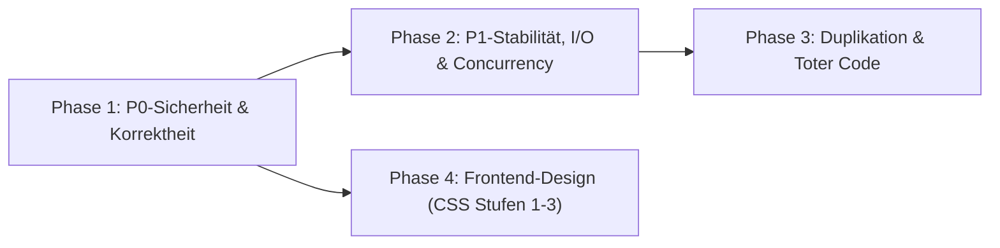

# Code-Audit & Implementierungsplan: Pipeline, Backend & Frontend-Modernisierung

**Datum:** 2026-11-21  
**Scope:** `tile_compile_cpp/` (Runner & Stacking-Bibliothek), `web_backend_cpp/` (Crow-C++20-Backend), `web_frontend_v3/` (GUI3-Frontend)  
**Architektur-Kontext:** Einzelmethoden-Pipeline (**CFA Forward Drizzle + Multiband**), C++20-Runner/Bibliothek, Crow-C++20-Backend, statisches ESM-Frontend ohne Build-Step.

---

## Inhaltsverzeichnis

- [Teil 1: Code-Audit der Implementierung](#teil-1-code-audit-der-implementierung)
  - [1.1 C++ Runner & Stacking-Pipeline (`tile_compile_cpp/`)](#11-c-runner--stacking-pipeline-tile_compile_cpp)
  - [1.2 C++ Web-Backend (`web_backend_cpp/`)](#12-c-web-backend-web_backend_cpp)
  - [1.3 Web-Frontend v3 (`web_frontend_v3/`)](#13-web-frontend-v3-web_frontend_v3)
- [Teil 2: Modernes Design-Konzept für `web_frontend_v3/`](#teil-2-modernes-design-konzept-für-web_frontend_v3)
  - [2.1 Visuelle Leitidee](#21-visuelle-leitidee-observatory-precision)
  - [2.2 Konkrete Modernisierungs-Hebel (natives CSS)](#22-konkrete-modernisierungs-hebel-100--natives-modernes-css)
  - [2.3 Zero-Regression-Vertrag](#23-zero-regression-vertrag)
- [Teil 3: Phasenweiser Implementierungsplan](#teil-3-phasenweiser-implementierungsplan)
  - [Abhängigkeitsgraph](#abhängigkeitsgraph)
  - [Phase 1: P0-Korrektheit, Sicherheit & kritische Bugs](#phase-1-p0-korrektheit-sicherheit--kritische-bugs)
  - [Phase 2: P1-Stabilität, Concurrency, i18n & Performance](#phase-2-p1-stabilität-concurrency-i18n--performance)
  - [Phase 3: Duplikation & Toter Code](#phase-3-duplikation--toter-code)
  - [Phase 4: Modernes Frontend-Redesign (Stufen 1–3)](#phase-4-modernes-frontend-redesign-stufen-13)
  - [Offene Entscheidungen](#offene-entscheidungen)
  - [Verifikationsplan](#verifikationsplan)

---

# Teil 1: Code-Audit der Implementierung

## 1.1 C++ Runner & Stacking-Pipeline (`tile_compile_cpp/`)

### A. Logiklöcher, Bugs & Edge Cases

| Prio | Bereich | Fund & Auswirkung | Quelle |
|---|---|---|---|
| **P0** | **Disk-Leak pro Lauf** | `write_forward_downstream_inputs` erzeugt ein `core::AtomicOutput`-Verzeichnis, schreibt 5 große FITS-Dateien hinein, kopiert sie nach `outputs/` und ruft **nie** `commit()` auf. `~AtomicOutput()` ruft `fs::remove` statt `remove_all` auf → scheitert lautlos mit `ENOTEMPTY`. Jeder Lauf hinterlässt ein volles Staging-Duplikat in `artifacts/forward_downstream_inputs.stage-*/payload/`. | `tile_compile_cpp/apps/runner_forward_output.cpp:129-147`, `tile_compile_cpp/include/tile_compile/core/atomic_output.hpp:42-48` |
| **P0** | **Doppeltes Denoising** | Im regulären Downstream-Lauf (`astrometry → bge → pcc`) laufen `luma_denoise` und `chroma_denoise("post_stack_linear")` im `bge`-Block. Ist `bge.method == "none"` (oder BGE übersprungen), ist im `pcc`-Block `have_bge_linear == false` → beide Denoiser laufen ein **zweites Mal** auf demselben Bild und werden doppelt in die JSON-Artefakte geschrieben. | `tile_compile_cpp/apps/runner_downstream.cpp:1178-1239`, `:1334-1390` |
| **P1** | **Resume-Blockade bei Downstream-Aktivierung** | War im Erstlauf `downstream_requested == false`, fehlt `checkpoint["normalization_bytes"]`. Aktiviert man später BGE/PCC/HMS und resümiert (obwohl `allowed_reconstruction_resume_sections` dies erlaubt), schlägt der Vergleich gegen `normalization_id` fehl (`FORWARD_STAGE_NORMALIZATION_PREDECESSOR_MISMATCH`). | `tile_compile_cpp/apps/runner_forward_drizzle.cpp:178-182`, `:468-474` |
| **P1** | **`std::terminate()` in Worker-Threads** | `parallel_for_indices` fängt in den Worker-Threads keine Exceptions aus `fn(i)` ab; jeder Fehler beendet den Prozess abrupt ohne `phase_end`/Error-Event oder Cleanup. | `tile_compile_cpp/apps/runner_shared.hpp:146-169` |
| **P1** | **Stille Schreibfehler / fehlendes `EINTR`** | `DiskCacheFrameStore::store` prüft bei `::write(...) <= 0` nicht auf `errno == EINTR` und schluckt Open-/Write-Fehler (z. B. Disk Full) stillschweigend (`has_data_[fi] = 0`). | `tile_compile_cpp/apps/runner_shared.cpp:1517-1528` |
| **P1** | **Nicht-atomare RGB-FITS-Writer** | `write_fits_rgb` und `write_fits_rgb_u32` schreiben direkt via `"!" + path` statt über Temp-Datei + Rename (im Gegensatz zu `write_fits_float`). Abbruch/Disk-Full erzeugt korrupte Zieldateien. | `tile_compile_cpp/src/io/fits_io.cpp:699-830` |
| **P1** | **Stilles YAML-Parse-Schlucken & Diff-Inkonsistenz** | `yaml_section_map` in `validate_provenance` fängt `catch (...) {}` ab und liefert eine leere Map (bei doppeltem Parse-Fehler passiert die Resume-Prüfung lautlos). Zudem vergleicht `validate_provenance` rohen YAML-Text, während `resume_downstream_command` re-serialisierte `Config`-Objekte vergleicht. | `tile_compile_cpp/apps/runner_forward_drizzle.cpp:193-228`, `:1467-1468` |
| **P2** | **Leere `run_id` bei Trailing Slash** | `fs::absolute(path).filename().string()` liefert bei `--run-dir runs/run_001/` in C++17 `""` → Events mit leerer `run_id`. | `tile_compile_cpp/apps/runner_forward_drizzle.cpp:1503`, `:1583-1587` |
| **P2** | **Fehlende Checks / Resume-Fragilität** | `internal_scale / output_scale` ohne Prüfung auf `output_scale > 0` / Teilbarkeit; `read_fits_header(entries[0].path)` wirft beim Resume, wenn Original-Lights verschoben wurden; Clone-Konstruktor von `VerifiedNormalizedSourceCache` fehlt der `size_t`-Overflow-Check. | `tile_compile_cpp/apps/runner_forward_output.cpp:71`, `:118`, `tile_compile_cpp/src/reconstruction/normalized_source_cache.cpp:124-135` |
| **P2** | **Irreführende `clipping`-Nullen & Doku-Drift** | `forward_drizzle.json` schreibt hartkodiert `0` für `pixel_channel_evaluations`, `pixel_channel_rejected`, `candidate_contributions_clipped` (echte v2-Zähler stehen nur im `phase_end`-Event). Doku erwähnt zudem noch `DEBAYER` und `PREWARP`-Events, die im Runner nicht mehr existieren. | `tile_compile_cpp/apps/runner_forward_drizzle.cpp:1140-1143`, `docs/guides/cfa_forward_drizzle_pipeline_de.md:47`, `docs/process_flow/phase_0_overview.md:45` |

### B. Optimierungsmöglichkeiten (Performance, RAM & I/O)

1. **Registrierungs-Proxies werden unmittelbar vor `REGISTRATION` verworfen und komplett neu berechnet:**
   - `runner_phase_metrics.cpp:180-182` berechnet und cached alle Proxies, doch `runner_pipeline.cpp:1663` ruft eine Zeile vor `run_phase_registration_prewarp` `release_registration_proxies()` auf. Alle normalisierten Frames werden in `runner_phase_registration.cpp:591-637` erneut geladen und die Proxies neu gebaut — und nach Ende der Registrierung nicht mehr freigegeben (bleiben während `FORWARD_DRIZZLE`/`MULTIBAND` im RAM).
2. **Mehrfach-FITS-I/O bei Downstream-Übergabe & Reloads:**
   - `runner_forward_output.cpp:136-147` schreibt dasselbe 3-Kanal-Float32-Volumen zweimal (`stacked_rgb.fits` + `stacked_rgb_solve.fits`) und kopiert danach alle Dateien per `fs::copy_file` statt atomarem Rename.
   - `runner_downstream.cpp:280` lädt stets `stacked_rgb_solve.fits`, selbst wenn beim Resume ab `PCC`/`HYPERMETRIC_STRETCH` oder im normalen BGE→PCC-Übergang (`:1351-1362`) sofort eine andere Datei geladen wird bzw. `rgb` bereits im RAM liegt.
3. **CPU-Full-Frame-Kernel (`forward_drizzle_v2_cpu.cpp`) seriell + Heap-Allokation pro Pixel:**
   - `end_pilot()` (`forward_drizzle_v2_cpu.cpp:2124-2231`) läuft ohne `#pragma omp parallel` und allokiert pro Pixel Knoten in `std::unordered_map<uint64_t, pair<int,int>> votes` (ersetzbar durch kleine Stack-Arrays + OpenMP). Auch `accumulate_frame_impl` (`:893`) ist rein seriell.
4. **Zeilenweise `seekg`/`read`-Loops & LRU-Bypass im Source-Cache:**
   - `normalized_source_cache.cpp:201-266` umgeht den `resident_`-LRU-Cache, öffnet pro Aufruf einen neuen `std::ifstream` und macht zeilenweise `seekg`+`read` — auch für zusammenhängende Vollzeilen (`x0 == 0 && x1 == width_`).
5. **Vermeidbare Allokationen/Vollbild-Kopien:**
   - `write_fits_rgb_u32` allokiert `std::vector<unsigned int>` in jeder Zeile (`fits_io.cpp:804-817`).
   - `to_mat` kopiert drei Vollbild-Luminanzvektoren statt `Eigen::Map` (`runner_forward_drizzle.cpp:987-995`).
   - Bedingungslose RGB-Vollbildkopie in `runner_phase_post_stack_output.cpp:25-27`.

### C. Doppelter Code & Toter Code

- **Duplikation:**
  - Exposure-Extraktion 3× (`runner_pipeline.cpp:264-273`, `runner_phase_metrics.cpp:33-46`, `runner_phase_preprocess_pipeline.cpp:197-200`); Master-Averaging & Kalibrierungs-Discovery 2× (mit abweichender `float`- vs. `double`-Präzision).
  - Resume-Section-Diffing 2× in `runner_forward_drizzle.cpp:193-247` & `:1440-1486`.
  - Denoise-Aufrufblöcke 2× copy-pasted in `runner_downstream.cpp:1189-1225` & `:1363-1390`.
  - Worker-Count-Berechnung + Env-Override 5× in `runner_forward_drizzle.cpp:380-639` (mit inkonsistentem Clamp).
- **Toter Code:**
  - Kompletter v1-Profil-Store (`drizzle_profile_store.cpp`, 471 LOC; `profile_store_manifest.cpp`, 195 LOC) sowie `stream_forward_drizzle_uniform`/`compute_forward_drizzle_uniform` (`forward_drizzle.cpp:1054-1224`) haben 0 Produktions-Aufrufer (nur noch Unit-Tests).
  - Test-Orakel/Test-Harness (`forward_drizzle_contrib_list.cpp`, `forward_drizzle_cuda_test_harness.cu`) sind fest in `tile_compile_lib` einkompiliert (`CMakeLists.txt:465`, `:514`).
  - 12 tote PREWARP-Felder in `PhaseRegistrationContext` (`runner_phase_registration.hpp:31-68`).
  - Unbenutzte Classic-Tile-Methoden `extract_tile`/`extract_tile_into` (`runner_shared.cpp:1557-1604`).
  - Unerreichbarer `!want_multiband`-Zweig in `runner_forward_drizzle.cpp:648-649` vs. `:1320-1323`.
  - Unbenutzte Legacy-Includes in `runner_phase_registration.cpp:1-16` und `runner_pipeline.cpp:22`.

---

## 1.2 C++ Web-Backend (`web_backend_cpp/`)

### A. Logiklöcher, Sicherheits- & Concurrency-Bugs

| Prio | Bereich | Fund & Auswirkung | Quelle |
|---|---|---|---|
| **P0** | **OS Command Injection** | `/api/fs/open` ruft `std::system("xdg-open '" + target.string() + "' ...")` (bzw. `open '...'`) auf. Ein Dateiname mit `'` bricht aus dem Quoting aus und führt beliebige Shell-Kommandos aus. Lösung: `fork`/`execvp` ohne Shell. | `web_backend_cpp/src/routes/system_routes.cpp:195-202` |
| **P0** | **Path-Traversal / Delete-Risiko** | `resolve_run_dir` akzeptiert beliebige absolute Verzeichnisse ohne `is_path_allowed()` und prüft nicht auf `..`. Zudem erlaubt der `run_id`-Sanitizer `.`, sodass `run_id=".."` durchgeht. In Kombination mit `POST /api/runs/<id>/delete` (`fs::remove_all`) kritisch. Weitere Lücken: `/api/scan/metrics` prüft `input_path` nicht; WebSocket `run_dir`-Query-Param ungeprüft; statischer UI-Server nutzt `lexically_normal()` + Präfix-Stringvergleich ohne Pfadtrenner (Symlink-/Sibling-Bypass). | `web_backend_cpp/src/backend_runtime.cpp:470-495`, `src/routes/runs_routes.cpp:265-277`, `:2347`, `src/main.cpp:328-336`, `src/routes/scan_routes.cpp:345-394`, `src/routes/ws_routes.cpp:266-274` |
| **P0** | **Live-Runner-Erkennung & Orphan-Cleanup defekt** | Prüfen noch auf die entfernten Legacy-Subcommands `arg == "run" \|\| arg == "resume"` statt `"reconstruct"` / `"resume-reconstruction"` / `"preprocess"`. Nach einem Backend-Neustart erkennt `has_live_runner_process()` aktive Läufe nicht und markiert sie fälschlich als `"aborted"`. | `web_backend_cpp/src/main.cpp:163-168`, `src/services/run_inspector.cpp:656-658` |
| **P1** | **Queue-Abbruch & Job-Status-Races** | (1) Queue-Loop setzt Status blind auf `running` *bevor* `queue_cancel_requested` geprüft wird → Abbruch geht verloren. (2) Subprocess-Start setzt `running` nach Thread-Start → sofort beendete Jobs bleiben dauerhaft auf `running`. (3) `SubprocessManager::cancel()` schläft 250 ms im detached Thread und setzt `proc->pid` nach `waitpid` nie auf `-1` → kann reaped/recycelte PIDs signalisieren. | `web_backend_cpp/src/routes/runs_routes.cpp:1669-1681`, `:1736-1758`, `src/subprocess_manager.cpp:596-646` |
| **P1** | **C++-Exception über C-Frame (`libcurl`) & `SIGPIPE`** | `progress_cb` wirft `JobCancelled` durch `libcurl` (UB); `SIGPIPE` wird nirgends ignoriert (Kindprozess, der stdin früh schließt, tötet das Backend); Download-Fehler ruft trotzdem `ensure_output_stream()` auf und trunkiert Zieldateien; `pipe()`-Teilfehler leaken FDs. | `web_backend_cpp/src/services/download_manager.cpp:193-209`, `:277`, `src/subprocess_manager.cpp:233-266` |
| **P1** | **Data Races & `job_id`-Sortierfehler** | Unsynchronisierte Lesezugriffe auf `active_config_revision_id` und `last_scan_input_path` ohne `state_mutex`. `job_id`-Stringvergleich (`"job_9_..." > "job_10_..."`) lässt Job 9 dauerhaft über Jobs 10–89 gewinnen. WebSocket `onaccept` leakt `new shared_ptr` bei `return false`. | `web_backend_cpp/src/routes/config_routes.cpp:307`, `src/routes/scan_routes.cpp:336-407`, `src/routes/ws_routes.cpp:612-633` |
| **P2** | **Weitere Edge Cases** | WebSocket-Queue-Deduplizierung wirkungslos (enthält `ts` im Fingerprint → sendet jede Sekunde alles neu); `preprocessing_service.cpp:297-300` markiert bei leerer `current_phase` alle Phasen als `running`; `job_store.cpp:170` Wrap-around bei negativem `limit`; Windows-Compile-Fehler in `runs_routes.cpp:40-44, 542-549` (`SHA256` ohne Guard); fehlendes Error-Handling bei `fs::directory_iterator`/JSON `.get<std::string>()`. | `web_backend_cpp/src/routes/ws_routes.cpp:344-444`, `src/services/preprocessing_service.cpp:297-300`, `src/job_store.cpp:170-175` |

### B. Optimierungsmöglichkeiten (Performance, Concurrency & RAM)

1. **Blocking I/O & Subprozesse unter Mutex-Locks:** `is_path_allowed()` macht `fs::weakly_canonical` auf jeden Root pro Dateieintrag unter `_roots_mutex` (`backend_runtime.cpp:559-565`); `config_routes.cpp:115-225` hält `config_write_mutex` über synchrone `run_subprocess`-Aufrufe; `pi_live_image_session.cpp:100-250` hält globalen `m_mutex` über volle OpenCV-Bildoperationen.
2. **SQLite-Neuöffnung bei jedem Request:** `PiDatabase::open()` hält nur `std::weak_ptr`, während Route-Handler lokale Store-Objekte erzeugen → jeder Request führt `sqlite3_open_v2`, 3× `PRAGMA` und `init_schema()` aus (`pi_database.cpp:194-224`).
3. **Schwere Polling- & Listing-Endpunkte:**
   - `ws_routes.cpp:399-473` liest jede Sekunde pro Client `run_events.jsonl` ab Byte 0 neu, parst `config.yaml` und scannt `/proc`.
   - `GET /api/runs/<id>/status` ruft `job_store.list(200)` **3×** pro Poll auf und öffnet bei `completed` jedes Mal SQLite (`runs_routes.cpp:1773-1804`).
   - `discover_runs()` durchläuft `runs_dir` rekursiv (inkl. `cache/`, `artifacts/`, `outputs/`) und parst alle Runs vollständig, bevor auf `limit` gekürzt wird (`run_inspector.cpp:933-972`).
   - `get-schema`/`dump-default-config` spawnen `tile_compile_cli` bei jedem Request ohne Cache (`config_routes.cpp:95-109`).
   - FITS-RGB-Preview-Reader öffnen denselben 3-Plane-FITS-Cube 3× separat und kopieren Multi-MB-Proxies by-value (`bge_preview_service.cpp:95-167`, `hme_preview_service.cpp:140-293`).
4. **Unbegrenztes Speicherwachstum:** `ConfigRevisionStore::_revisions` (kein Cap), `pi_live_image_session` Undo/Redo-Stacks (volle `CV_32FC3`-Klone ohne Tiefenlimit), `/artifacts/view` & `/artifacts/raw` (kein Größenlimit), `ui_events.jsonl` (keine Rotation/Kompaktierung).

### C. Doppelter Code & Toter Code

- **Duplikation:** 3 inkompatible JSON-Fehlerformate; URL-/Base64url-Decoder (3×); SHA-256-Helper (4×); `utc_now_iso` (3×); `/proc`-Enumeration + `terminate_pid_group` (3×); `run_events.jsonl`-Lookup (3×); FITS-Plane-Reader/Resizer (3×); `run_id`-Sanitizer (2×); `event_ts_seconds` (2× in derselben Datei `run_inspector.cpp`); 3 identische Archiv-Extraktionsblöcke in `tools_routes.cpp:1047-1086`.
- **Toter Code:** `BackendRuntime::input_search_roots()`, `SubprocessManager::cancel_by_run()`, `BackgroundProcess::process_handle`, `ConfigRevisionStore::latest_id()`, `PiMemoryStore::legacy_reviews_path()`, `parse_event_ts_seconds()`, `payload_text()`, ungenutzter `ConfigRevisionStore`-Parameter in `register_config_routes()`, unerreichbarer `status == "error"`-Guard in `runs_routes.cpp:1382-1386`, Legacy-`gui2`-Keys (`TILE_COMPILE_GUI2_INSTALL_ROOT`, `gui2.locale`).

---

## 1.3 Web-Frontend v3 (`web_frontend_v3/`)

### A. Logiklöcher, Bugs & Edge Cases

| Prio | Bereich | Fund & Auswirkung | Quelle |
|---|---|---|---|
| **P0** | **WebSocket Auto-Reconnect defekt** | `ws.onclose` setzt `ws` nicht auf `null`. Wenn der 3s-Reconnect-Timer `connectWebSocket(..., false)` aufruft, greift das Early-Return (`if (ws && ...) return;`) → nach Verbindungsabbruch wird **nie** neu verbunden. Bei Run-Wechsel ohne `force=true` wird zudem der alte Socket geleakt. | `web_frontend_v3/js/components/ws-manager.js:13-21`, `:43-49` |
| **P1** | **Stille Unterdrückung von Warnungen im Log** | `log-viewer.js` filtert auf `["INFO","WARN","ERROR","DEBUG","TRACE"]`, aber `run-monitor.js` setzt für Warning-Events `level = "WARNING"`. Alle geladenen Warnungen verschwinden lautlos aus dem Log-Viewer. | `web_frontend_v3/js/components/log-viewer.js:14`, `js/pages/run-monitor.js:1781` |
| **P1** | **Broken i18n & Initial-Rendering** | (1) `SUB_TABS` ruft `t()` beim Modul-Import auf, *bevor* `loadLocale()` lief → Sub-Tab-Labels bleiben immer auf Fallback-Text. (2) `ai-empfehlung.js` sucht `#ai-recommendations` synchron vor dem DOM-Append → State-Wiederherstellung bei Tab-Wechsel scheitert still. (3) 14 `param.hypermetric_stretch.*.explain`-Keys fehlen in `en.json`; 52 `t()`-Aufrufe referenzieren Keys, die in **beiden** JSONs fehlen. | `web_frontend_v3/js/main.js:22-52`, `js/pages/ai-empfehlung.js:264-281`, `i18n/en.json` |
| **P1** | **XSS / unescaped `innerHTML`** | Fallback-Log-Renderer in `run-monitor.js` und mehrere Stellen in `run_dashboard.html` interpolieren Status/Pfade/Log-Text direkt in `innerHTML`. | `web_frontend_v3/js/pages/run-monitor.js:1801`, `run_dashboard.html:216-285` |
| **P1** | **Navigations-, Race- & Storage-Bugs** | (1) Run-History-Wechsel löst `hashchange` + `tc-subtab-change` doppelt aus → Run-Monitor mountet 2×. (2) `ArrowLeft`/`ArrowRight`-Shortcut aktualisiert weder `ui-state` noch aktiven Sub-Tab-Style. (3) Fehlende Request-Generation-Guards in `run-image-preview.js`, `run-history.js` (`renderCompare`) und `bge-preview.js` (`switchView`). (4) `localStorage.setItem` ohne `try/catch` (`QuotaExceededError`-Crash). (5) `run_dashboard.html` aktualisiert `artifactListCache` nie nach dem 1. Tick. | `web_frontend_v3/js/pages/run-history.js:274-276`, `js/main.js:192-206`, `js/state/store.js:28`, `run_dashboard.html:190-202` |
| **P2** | **Kaputte CSS-Selektoren & fehlende Tokens** | `run-history.js` toggelt `.selected`, aber CSS stylt nur `.active` (Auswahl-Highlight fehlt). 8 CSS-Variablen (`--radius-md`, `--surface-3`, `--text`, `--text-muted`, `--border-strong`, `--accent`, `--tc-border-color`, `--tc-danger`/`--tc-success`) sind nicht in `tokens.css` definiert. | `web_frontend_v3/js/pages/run-history.js:137-147`, `css/components.css:718-1116` |

### B. Optimierungsmöglichkeiten (Rendering, Netzwerk & Memory Leaks)

1. **O(N²) DOM-Neuaufbau im Log-Viewer:** `addLine()` leert und baut bis zu 10.000 DOM-Knoten bei jeder einzelnen Zeile neu; `loadInitialLogs()` ruft `addLine()` in einer Schleife auf statt `addLines()`. Suche ist un-debounced (`log-viewer.js:42-113`, `run-monitor.js:1770-1795`).
2. **Doppeltes Status-Polling & nicht gestoppte Timer:** `startPolling()` ruft alle 3s `/status` in eine ungenutzte Variable `const status` ab und direkt danach `refreshRunStatus()` (2× Traffic). Weil `main.js:renderContent()` keinen Unmount-Lifecycle hat, laufen Polling-Intervalle auch nach dem Verlassen der Seite weiter (`run-monitor.js:1538-1540`, `main.js:126-141`).
3. **Memory- & Listener-Leaks:**
   - `run-monitor.js:205-213` verwirft die Unsubscribe-Funktion von `onWebSocketMessage()` → jeder Seitenbesuch leakt einen kompletten DOM-Closure und vervielfacht WS-Events/Toasts.
   - `live-image-viewer.js:254-268, 1448-1530` hängt anonyme `window`-`mousemove`/`mouseup`-Listener an, die in `doClose()` nie entfernt werden.
   - `bge-preview.js` / `hms-preview.js` leaken `URL.createObjectURL` bei Bildladefehler.
4. **Synchrones `localStorage`- & YAML-Churn pro Tastendruck:** Jeder Tastenanschlag in `parameter.js:466-471` serialisiert 2× den kompletten `config-state` inkl. gesamtem JSON-Schema in `localStorage` + volle YAML-Serialisierung + Diff.
5. **Überdimensionierte Abfragen:** `run-history.js:342` lädt bis zu **99.999 Logzeilen** für zwei Runs im Vergleich; `ai-empfehlung.js:256-273` feuert 8 uncached Requests bei jedem Tab-Wechsel; `run_dashboard.html:203-223` pollt bis zu 10 Artefakte sequentiell alle 5s.

### C. Doppelter Code & Toter Code

- **Duplikation:** AI-Traffic-Log-Loader/Poller/Renderer 3× (`ai-empfehlung.js` + 2× in `run-monitor.js`); Canvas-Preview-Modal (Pan/Zoom/Histogramm/YAML-Patch) 2× (`bge-preview.js` vs. `hms-preview.js`); private API-Aufrufe (`_toWsUrl`, `_toHttpUrl`) + direkte `fetch()`-Calls statt `ApiClient`; doppelte CSS-Definitionen (`.tc-modal-overlay`, `.tc-diff-added`, `.tc-run-list`); inline-CSS in `run_dashboard.html`.
- **Toter Code:**
  - **~280 LOC unerreichbares `runChat`-Subsystem** in `run-monitor.js:185`, `:1245-1522` (`!document.getElementById("assistant-dock")` ist immer `false`, weil `main.js:70` das Dock immer mountet).
  - Unerreichbare `hms`/`bge`-Zweige in `run-image-preview.js:42-74`.
  - 17 ungenutzte Keys in `js/api/endpoints.js`, ungenutzte Exports (`readBgeYaml`, `patchBgeYaml`, `readHmsYaml`, `patchHmsYaml`, `liveImageOperationLabel`, `refreshRunImagePreviewPanel`, `deriveCalValuesFromConfig`), totes `_api` in `store.js:49-53`, ungenutzte CSS-Tokens & 15 ungenutzte CSS-Klassen.

---

# Teil 2: Modernes Design-Konzept für `web_frontend_v3/`

Das GUI3-Frontend hat keinen Build-Step und basiert auf Vanilla-ESM + 5 CSS-Dateien (`tokens.css`, `base.css`, `layout.css`, `components.css`, `pages.css`). Das Erscheinungsbild lässt sich **rein über CSS + gezielte Token-Bereinigung** modernisieren — ohne Workflows, Routen, Event-Logik oder Datenflüsse zu verändern.

## 2.1 Visuelle Leitidee: „Observatory Precision“

- **Tiefe statt harter Rahmen:** 4 abgestufte Surface-Ebenen (`canvas` → `surface-1` → `surface-2` → `surface-elevated`) mit feinen, halbtransparenten Hairline-Borders (`color-mix(in oklch, var(--foreground) 10%, transparent)`).
- **WCAG-AA-Kontrast im Dark-Mode:** Tiefes Nachtblau/Obsidian als Canvas, gedämpfte Cyan/Teal-Akzente mit dunkler Textfarbe `--on-primary: #042f2e` auf `--primary` (`#2dd4bf`) statt `#fff` (aktuell nur ~1,8:1 Kontrast → nach Fix >10:1).
- **Technische Präzision:** `font-variant-numeric: tabular-nums` auf allen Metriken, FWHM-/SNR-Werten, Phasen-Timings, Frame-Tabellen und Fortschrittsbalken.

## 2.2 Konkrete Modernisierungs-Hebel (100 % natives modernes CSS)

1. **CSS-Cascade mit `@layer` & Token-Bereinigung:**
   - `@layer tokens, base, layout, components, pages, utilities;` beseitigt Spezifitätskämpfe und doppelte Überschreibungen.
   - Fehlende Tokens (`--radius-md`, `--surface-3`, `--text`, `--text-muted`, `--border-strong`, `--accent`) sowie Z-Index-Skala (`--z-header`, `--z-dock`, `--z-modal`, `--z-toast`, `--z-viewer`) sauber definieren.
   - Hover-, Active-, Focus-Ring- und Badge-Flächen dynamisch über `color-mix()` ableiten.
2. **Typografie, Lesbarkeit & Card-Hierarchie:**
   - Globales `word-break: break-all` von `.tc-card` (`components.css:88`) entfernen; `overflow-wrap: anywhere` nur für Pfade/Hashes (`.tc-mono`, `.tc-path`).
   - Abgestufte Primär-Cards vs. ruhige Inset-Sub-Panels (behebt „Card-in-Card“ im Parameter Studio).
3. **Layout-Kohärenz & Container Queries (`@container`):**
   - Gemeinsame `max-width`-Variable (`--content-max: 1360px`) für Header-Inhalt, `.tc-subtab-bar` und `#content`; synchrones Einrücken von `.tc-subtab-bar` und `#content` bei `html.tc-dock-open`.
   - Sticky Glassmorphism-Subtab-Leiste (`position: sticky; top: 56px; backdrop-filter: blur(12px)`).
   - Container Queries (`container-type: inline-size`) für `.tc-queue-row`, `.tc-param-grid` und Multi-Column-Grids.
   - Responsive Modals (`width: min(92vw, 640px)` statt starrer `min-width: 500px`/`600px`).
4. **Komponenten- & A11y-Veredelung:**
   - Konsistente Segmented-Control-Tabs (`.tc-tabs`/`.tc-tab`), Pipeline-Stepper-Optik für die Phasenliste im Run-Monitor, `color-scheme: dark` / `light` für native Form-Controls/Scrollbars.
   - Fix für `.tc-run-item.selected` + `.active`.
   - Durchgängige `:focus-visible`-Ringe und `@media (prefers-reduced-motion: reduce)`.

## 2.3 Zero-Regression-Vertrag

Folgende Verträge bleiben unverändert erhalten:
- **Root-Attribute & Klassen:** `html[data-theme="dark"|"light"]`, `html[lang="de"|"en"]`, `html.tc-dock-open`, `--assistant-width`.
- **Shell- & Navigations-IDs:** `#app-root`, `#toast-container`, `#header-tabs`, `#subtab-bar`, `#content`, `.tc-tab[data-tab]`, `.tc-tab[data-subtab]`, `[data-guardrail]`, `.tc-badge-running`.
- **Tab-Vertrag:** `.tc-tabs`, `.tc-tab`, `.active`, `role="tablist"`/`"tab"`, `aria-selected`.
- **Browser-Test- & Assistenten-Selektoren:** `#assistant-dock`, `.tc-assistant-dock`, `.tc-dock-launcher`, `#resume-config-yaml`, `#resume-panel`, `.tc-hidden`, `#run-list .tc-run-item[data-run-id]`, `.tc-run-archive`, `[data-archive-list]`, `#jev-*`, `#post-run-advice-*`.
- **Live-Image-Viewer & Preview-Canvas:** Alle `.live-image-viewer*`-Klassen, `position: relative; overflow: hidden` auf `__image-wrap`, `position: fixed` auf `__operation-editor`, reines `#000` als Bild-Canvas-Hintergrund.

---

# Teil 3: Phasenweiser Implementierungsplan

## Abhängigkeitsgraph



## Phase 1: P0-Korrektheit, Sicherheit & kritische Bugs

### 1A. C++ Runner & Pipeline (`tile_compile_cpp/`)
- **Blast Radius:** Runner-Ausgabepfad, Downstream-Denoising, Registrierungs-Cache.
- **Risiko:** Mittel (Verifikation über Runner- und Unit-Tests erforderlich).
- **Dateien:**
  - `tile_compile_cpp/include/tile_compile/core/atomic_output.hpp`: `fs::remove_all(staged_, ec)` im Destruktor.
  - `tile_compile_cpp/apps/runner_forward_output.cpp`: Atomares Staging per Datei / `fs::rename` + Cleanup, Vermeidung doppelten FITS-Schreibens für `stacked_rgb_solve.fits`, Prüfung auf `output_scale > 0 && internal_scale % output_scale == 0`.
  - `tile_compile_cpp/apps/runner_downstream.cpp`: Guard-Flag `post_stack_denoise_applied` gegen doppeltes Denoising bei `bge.method == "none"`; Vermeidung redundanter FITS-Reloads.
  - `tile_compile_cpp/apps/runner_pipeline.cpp`: `frame_cache->release_registration_proxies()` von vor auf unmittelbar nach `run_phase_registration_prewarp(...)` verschieben.

### 1B. C++ Web-Backend (`web_backend_cpp/`)
- **Blast Radius:** Dateisystem-/Shell-Sicherheitsgrenzen, Live-Runner-Erkennung, Queue-/Subprocess-Lifecycle.
- **Risiko:** Hoch bei Fehlkonfiguration von Pfad-Checks (Absicherung durch Backend-Contract-Tests).
- **Dateien:**
  - `web_backend_cpp/src/routes/system_routes.cpp`: `/api/fs/open` von `std::system(...)` auf shell-freies `fork`/`execvp` umstellen.
  - `web_backend_cpp/src/backend_runtime.cpp`: `resolve_run_dir` mit `is_path_allowed()` und `..`-Ablehnung absichern.
  - `web_backend_cpp/src/routes/runs_routes.cpp` & `preprocessing_routes.cpp`: `.`/`..` im `run_id`-Sanitizer ablehnen; Queue-Cancel-Prüfung vor `update_state(..., running)`; atomare Initial-Daten vor Thread-Start.
  - `web_backend_cpp/src/main.cpp` & `src/services/run_inspector.cpp`: Orphan-Cleanup & `has_live_runner_process()` auf `"reconstruct"`, `"resume-reconstruction"`, `"preprocess"` umstellen; statischen UI-Server mit kanonischer Pfadprüfung + Pfadtrenner absichern.
  - `web_backend_cpp/src/routes/scan_routes.cpp` & `ws_routes.cpp`: `input_path` und `run_dir` gegen `is_path_allowed()` prüfen; `onaccept`-Leak und Queue-Fingerprint (`ts`) fixen.

### 1C. Web-Frontend v3 (`web_frontend_v3/`)
- **Blast Radius:** WebSocket-Reconnect, Live-Log-Viewer, Status-Polling, XSS-Schutz.
- **Risiko:** Gering.
- **Dateien:**
  - `web_frontend_v3/js/components/ws-manager.js`: `ws = null` in `onclose`; sauberes Schließen bei Run-Wechsel.
  - `web_frontend_v3/js/components/log-viewer.js` & `js/pages/run-monitor.js`: `"WARNING"` → `"WARN"` normalisieren; inkrementelles Rendering / `addLines()` + Such-Debouncing; doppelten `/status`-Call entfernen; Unmount-Cleanup für Timer & `onWebSocketMessage`; XSS-sicheres DOM-Rendering im Fallback-Log.

---

## Phase 2: P1-Stabilität, Concurrency, i18n & Performance

- **C++ Pipeline:** `std::exception_ptr` in `parallel_for_indices` (`runner_shared.hpp`); `EINTR`-Retry + Fehlerpropagation in `DiskCacheFrameStore::store` (`runner_shared.cpp`); `normalization_bytes`-Checkpoint + Trailing-Slash-`run_id` + YAML-Parse-Fehler + echte v2-Clipping-Zähler (`runner_forward_drizzle.cpp`); atomare `write_fits_rgb*` + Zeilenbuffer außerhalb der Schleife (`fits_io.cpp`); OpenMP + Stack-Struktur in `end_pilot()` (`forward_drizzle_v2_cpu.cpp`); LRU-Hit-Check & Vollzeilen-`read()` (`normalized_source_cache.cpp`).
- **C++ Backend:** `SIGPIPE` ignorieren + FD-Cleanup + `proc->pid = -1` nach `waitpid` (`subprocess_manager.cpp`); Cancel über Return-Code statt Exception über `libcurl` + kein Trunkieren bei Download-Fehler (`download_manager.cpp`); Connection-Haltung in `PiDatabase` (`pi_database.cpp`); kleinere Mutex-Scopes, Schema-/Default-Config-Cache, `discover_runs`-Optimierung, `job_id`-Sortierfix, Memory-Caps für Revisionen/Undo-Stacks/Artefakt-Views.
- **Frontend v3:** `SUB_TABS` nach `loadLocale()`, Page-Unmount-Hook & `ArrowLeft`/`ArrowRight`-Sync (`main.js`); fehlende i18n-Keys in `de.json`/`en.json` angleichen; `oninput`-Debouncing & `try/catch` für `parseYaml`/`localStorage` (`parameter.js`, `store.js`); `window`-Listener-Cleanup in `live-image-viewer.js`; XSS-Escaping + paralleles Polling + Cache-Refresh in `run_dashboard.html`.

---

## Phase 3: Duplikation & Toter Code

- **C++ Pipeline:** Gemeinsame Kalibrierungs-/Exposure-/Worker-Count-/Resume-Diff-Helfer; tote PREWARP-Felder (`runner_phase_registration.hpp`), `extract_tile*` (`runner_shared.*`), unerreichbare `!want_multiband`-Zweige und ungenutzte Includes entfernen; Test-Orakel/Harness aus `tile_compile_lib` in Test-Targets verschieben (`CMakeLists.txt`).
- **C++ Backend:** Vereinheitlichung von Error-Envelopes, URL/Base64url, SHA-256, `utc_now_iso`, `/proc`-Helfern, FITS-Plane-Readern; Entfernen der 8 ungenutzten Methoden/Felder und Legacy-`gui2`-Überbleibsel.
- **Frontend v3:** Entfernen des unerreichbaren `runChat`-Subsystems (~280 LOC in `run-monitor.js`), toter Preview-Zweige (`run-image-preview.js`), ungenutzter Exports/Endpoints/CSS-Klassen; gemeinsame AI-Traffic-Log- und Canvas-Preview-Helfer.

---

## Phase 4: Modernes Frontend-Redesign (Stufen 1–3)

1. **Stufe 1 (`tokens.css`, `base.css`):** `@layer`-Architektur, fehlende Tokens ergänzen, WCAG-AA-Kontrastfix (`--on-primary`), `color-scheme`, `tabular-nums`, `:focus-visible`, `prefers-reduced-motion`.
2. **Stufe 2 (`layout.css`, `components.css`):** Doppelte Selektoren bereinigen, `word-break: break-all` fixen, `.tc-run-item.selected` stylen, `--content-max` & Dock-Sync für `.tc-subtab-bar`, `@container`-Queries, responsive Modals, veredelte Tabs & Pipeline-Stepper-Optik.
3. **Stufe 3 *(optional)* (`pages.css`, `bge-preview.js`, `hms-preview.js`, `run_dashboard.html`):** Inset-Sub-Cards im Parameter Studio, Ablösung der `--tc-*`-Inline-Styles durch CSS-Klassen, gemeinsame Stylesheets in `run_dashboard.html`.

---

## Offene Entscheidungen

1. **v1-Profil-Store (`drizzle_profile_store.cpp`, `profile_store_manifest.cpp`):** In Phase 3 inkl. isolierter Unit-Tests entfernen oder als Referenz im Build belassen?
2. **Frontend-Redesign-Umfang:** Nur Stufen 1–2 (100 % reines CSS) oder inkl. Stufe 3 (Inline-Styles & `run_dashboard.html`)?
3. **`mkdocs.yml`:** Soll dieses Dokument zusätzlich in `mkdocs.yml` verlinkt werden?

---

## Verifikationsplan

### Automatisierte Tests (gemäß `AGENTS.md` mit Umleitung nach `/tmp/out_*.txt`)

```bash
# C++ Pipeline & Runner
cmake --build tile_compile_cpp/build --target tile_compile_runner tests -j2 > /tmp/out_cpp_build.txt 2>&1
./tile_compile_cpp/build/tests > /tmp/out_cpp_tests.txt 2>&1

# C++ Web-Backend
cmake --build web_backend_cpp/build -j2 > /tmp/out_backend_build.txt 2>&1
ctest --test-dir web_backend_cpp/build --output-on-failure > /tmp/out_backend_tests.txt 2>&1
```

- **Frontend v3:** Bestehende Tests unter `web_frontend_v3/tests/` (`jev_ui.test.mjs`, `assistant-dock.browser.mjs`, `assistant-action-card.browser.mjs`, `reason-picker.browser.mjs`, `run-learning-archive.browser.mjs`) sowie JSON-Syntaxprüfung für `web_frontend_v3/i18n/de.json` und `en.json`.

### Manuelle Verifikation (Frontend-Redesign)
- Gegen das laufende Backend (`http://127.0.0.1:8080/ui`, keinen eigenen Backend-Prozess starten) im Dark- und Light-Mode prüfen:
  - Desktop (`1440px`, `1280px` mit offenem und geschlossenem Assistant-Dock) und Mobile (`768px`, `390px`).
  - Alle Tabs/Sub-Tabs (Processing, Tools, History) sowie Modals (Path Picker, BGE/HMS Preview, Live Image Viewer).
  - Tastaturfokus (`Tab`-Navigation) und Kontrast der Primary-Buttons im Dark-Mode.

---

# Umsetzungsstand (2026-11-21, ohne Teil 2 „Design“)

Verifiziert mit frischen Builds gegen CUDA 13.5 und OpenCV 4.11 (`~/.local/opencv-cuda13-4.11`):
C++-Tests 519/519 Testfälle grün; Backend-`ctest` 32/33 (auch im Repo-Build, dreimal parallel stabil). Der eine Fehlschlag, `web_backend_cpp_run_start_naming`
(„queue with exact scanned FITS starts“, `JEV_PROPOSAL_STALE: saved Jev config revision is not active`), bestand schon
vor diesen Änderungen und hängt nicht mit dem Audit zusammen (der Test verknüpft einen Vorschlag mit der Revision
`saved_cfg`, aktiviert aber keine). Frontend: `node --test tests/audit_fixes.test.mjs tests/jev_ui.test.mjs` 8/8;
die `*.browser.mjs`-Tests nicht ausgeführt (Playwright ist nicht installiert). Sidecar mit pi 1.6.0: Live-Smoke-Test (`/health`, `/models`, `/test` mit einem echten Modellaufruf) erfolgreich.

Legende: **erledigt** · **teilweise** · **offen**

## 1.1 Pipeline
| Punkt | Stand | Umsetzung / Grund |
|---|---|---|
| P0 Disk-Leak | erledigt | `~AtomicOutput` räumt das Staging-Verzeichnis mit `remove_all`; `write_forward_downstream_inputs` verschiebt die Dateien per `rename` und `commit`. Test `artifact audit: a staged directory payload leaves no staging dir`. |
| P0 Doppeltes Denoising | erledigt | Flag `post_stack_denoise_done` in `runner_downstream.cpp`; ein Resume ab PCC entrauscht weiterhin. Test `forward downstream BGE resume without BGE denoises once` (schlug vorher mit 2 Durchläufen fehl). |
| P1 `std::terminate` in Workern | erledigt | `parallel_for_indices` fängt die erste Exception, stoppt die übrigen Indizes und wirft sie nach dem Join erneut. Test `[parallel]`. |
| P1 Resume-Blockade `normalization_bytes` | erledigt | Jeder Checkpoint hält die Größe von `normalization.json`, auch ohne Downstream-Phasen; ein älterer Checkpoint ohne den Wert wird beim Resume angenommen, einer mit abweichendem Wert weiter abgelehnt. Test `forward run made without downstream phases can be resumed with them`. |
| P1 `EINTR` / stille Schreibfehler im DiskCache | erledigt | `DiskCacheFrameStore::store` wiederholt `open`/`write` bei `EINTR`, löscht eine Teildatei und wirft `DISK_CACHE_WRITE_FAILED` (Windows: `WriteFile` in Blöcken). Test `[disk-cache]`. |
| P1 Nicht-atomare RGB-FITS-Writer | erledigt | `write_fits_rgb` und `write_fits_rgb_u32` schreiben über `AtomicOutput` (Staging + `commit`). |
| P1 YAML `catch (...)` / Diff-Inkonsistenz | erledigt | Ein gemeinsamer Abschnittsvergleich (`config_sections`, `out_of_scope_changes`) für Provenienz und Resume; unlesbares YAML wirft `FORWARD_STAGE_CONFIG_UNPARSEABLE` statt als „keine Änderung“ zu gelten. |
| P2 Skalen-Prüfung | erledigt | `FORWARD_OUTPUT_SCALE`-Guard (`output_scale ≥ 1`, Vielfaches). |
| P2 `read_fits_header` beim Resume, Overflow im Cache-Klon, Trailing-Slash-`run_id` | erledigt | Ein unlesbarer Quell-Header warnt (`FORWARD_OUTPUT_SOURCE_HEADER_UNAVAILABLE`) statt abzubrechen; der Klon-Konstruktor prüft Budget und Overflow wie der primäre; `run_id` mit `/` am Ende wird normalisiert. |
| P2 Clipping-Nullen / Doku-Drift | erledigt | Kein Konsument liest den Block. `forward_drizzle.json` schreibt `null` und `measured: false` statt `0` und verweist auf die `v2_*`-Zähler im `phase_end`-Event (getestet). `DEBAYER` aus den Guides (de/en) entfernt; `PREWARP` ist in den Process-Flow-Dokumenten als reines Log-Präfix beschrieben. |
| B: `stacked_rgb_solve.fits` | erledigt | Kopie statt zweitem Schreiben. |
| B: `end_pilot`-OpenMP, Source-Cache-Lesen, `to_mat`-Kopien, Registrierungs-Proxies | teils erledigt, teils verworfen (Vergleichslauf M31 2026-11-21/22) | Zwei M31-Läufe (645 Frames, Config des Laufs von 17:11, beide aus demselben Build): Baseline und neuer Code. Alle 670 FITS-Dateien (darunter 645 kalibrierte Frames und die Endbilder) und alle 89 Drizzle-Band-Dateien sind bitgleich; die JSON-Dateien unterscheiden sich nur in Build-Angaben und Generations-Hash. **Erledigt:** RGB-Kopie ohne Maske/Stretch entfällt; Denoise-Blöcke in `runner_downstream.cpp` zu einer Funktion; Kalibrier-Discovery und -Mittelung gemeinsam (`runner_shared.cpp`, double-Summe, NaN pro Pixel ausgelassen; ändert Ergebnisse nur bei aus Einzelframes gemittelten Masters bzw. NaN im Master, M31 unverändert). **Verworfen:** Übernahme der Registrierungs-Proxies aus der Normalisierung. Ausgabe gleich, aber Spitzen-RSS 21,1 statt 13,8 GB (über `memory_budget_mb` 16384; Ende der Registrierung 12,7 statt 4,9 GB) und kein messbarer Zeitgewinn; zurückgenommen. **Nicht gemacht:** `to_mat`-Kopien (drei Kopien einmal pro Lauf; dafür müssten 29 Aufrufer die Signatur wechseln, was intern neue Kopien erzeugt). **Nicht belegt:** `end_pilot`-OpenMP und Source-Cache-Lesen stecken in beiden Läufen; der Lauf von 17:11 taugt nicht als Gegenprobe, weil der Build seitdem gegen das System-OpenCV ohne CUDA linkt (Prewarp `opencv_opencl` statt `opencv_cuda`, anderer `quality_plan_hash`). |
| C: Worker-Anzahl 5× | erledigt | `hardware_workers`/`configured_workers`/`env_workers` in `runner_forward_drizzle.cpp`; jede Phase behält ihr Verhalten (Geometrie-Cache ab Kernzahl, Forward Drizzle begrenzt auch den Override auf die Kernzahl), jetzt benannt statt fünfmal kopiert. |
| C: Belichtungszeit 3× | erledigt (2 von 3) | `runner::header_exposure_seconds` ersetzt die Kopien in `runner_pipeline.cpp` und `runner_phase_metrics.cpp` (mit Trimmen von String-Werten, das der Metrics-Kopie fehlte). Die Preprocessing-Variante (nur EXPTIME/EXPOSURE, 0 erlaubt) bleibt: sie steuert die Dark-Auswahl, eine Änderung wählte andere Darks. |
| C: toter Code | erledigt | `DiskCacheFrameStore::extract_tile`/`extract_tile_into`; der unerreichbare `else`-Zweig (`reconstruction_ready`) und die immer wahren `want_multiband`-Bedingungen nach `FORWARD_DRIZZLE_V2_REQUIRES_MULTIBAND`; `PhaseRegistrationContext` auf die beschriebenen Felder reduziert (Prewarp-Stores, Masken, Zähler, Canvas-Maße/Offsets wurden nie geschrieben oder nie gelesen). |
| C: `model_predicted_mask`, `registration_residual_weight_factors` | erledigt | Redundante Kopien, entfernt. Die Gewichtsstrafe fehlt **nicht**: Forward Drizzle liest `model_prediction_factor` und `registration_residual_factor` aus dem Sampling-Plan (`g_eff = g_quality × model_prediction_factor × registration_residual_factor`, `quality_frame_weight_plan.cpp`). Die frühere Notiz „Strafe fehlt seit ababbfba“ war falsch. |
| (neu) Schlecht vorhergesagte Frames | erledigt (entschieden 2026-11-21) | Modellvorhergesagte Warps waren unbrauchbar (ic434: Median-Residuum 1,89 Proxy-px gegen 0,07 bei direkten). Neue Option `registration.model_prediction_max_residual_px` (Standard 0,7; 0 schaltet ab): ein vorhergesagter Frame mit größerem oder nicht messbarem Residuum wird im Sampling-Plan ungültig und fehlt im Stack (Warnung mit den Frames). Schema, Defaults, Doku (de/en), i18n (de/en). Tests `[registration]`, `[config]`. M31 hat keine vorhergesagten Frames. |
| C: v1-Profil-Store | erledigt (entschieden 2026-11-21) | `drizzle_profile_store.{hpp,cpp}`, `profile_store_manifest.{hpp,cpp}` und ihre zwei Testdateien entfernt (1282 Zeilen). `DrizzleStoreIdentity` und `MultibandStoreContract`, die v2 noch braucht, stehen jetzt in `drizzle_store_identity.hpp`. |
| C: `stream/compute_forward_drizzle_uniform`, Contrib-List, CUDA-Test-Harness in der Lib | erledigt (Harness) | Der Clip-Paritäts-Harness (`forward_drizzle_cuda_polygon_rect_area_batch`) ist aus `tile_compile_lib` in das Test-Target verschoben (`tests/support/forward_drizzle_cuda_harness.{cu,hpp}`, gleiche `--fmad=false`-Regel), seine Deklaration aus dem Produktions-Header entfernt; die Lib enthält das Symbol nicht mehr. `[cuda-parity]` grün. Bleiben (kein Testcode): die CPU-Referenz `stream/compute_forward_drizzle_uniform` (~10 Testdateien), die Contrib-List (produktiv in v2) und `forward_drizzle_cuda_local_dense_scatter` (startet den Produktionskernel, ohne `-rdc` nur in dessen TU möglich). |
| C: Master-Averaging/Kalibrierungs-Discovery 2×, Denoise-Blöcke 2× | erledigt | `runner::average_calibration_frames` und `runner::discover_calibration_frames` (`runner_shared`) ersetzen beide Kopien. Gewählt ist die bessere Variante: Summe in `double`, nicht-endliche Werte je Pixel ausgelassen. **Ändert Ergebnisse** dort, wo der Runner Masters aus Einzelframes mittelt (vorher `float`-Summe, NaN steckte an), und bei einem expliziten Master mit NaN-Pixeln (jetzt 0). Test `[calibration]`. Die Denoise-Blöcke waren dieselben Aufrufe (kein float/double): ein Lambda `run_post_stack_linear_denoise` in `runner_downstream.cpp`, numerisch unverändert. |

## 1.2 Backend
| Punkt | Stand | Umsetzung / Grund |
|---|---|---|
| P0 Command Injection `/api/fs/open` | erledigt | `posix_spawnp` ohne Shell, stdio auf `/dev/null`, eigene Session; ein abgekoppelter Thread holt den Kindprozess ab, SIGCHLD bleibt unberührt. `TILE_COMPILE_OPEN_COMMAND` ersetzt den Opener (Tests). Test `web_backend_cpp_audit_security` mit einem Pfad aus `'`, `$( )` und `;`. |
| (neu) P0 Cross-Site-Requests (CORS `*`, kein Login, `parse_body` ohne Content-Type-Prüfung) | erledigt | Middleware `OriginGuardMiddleware` (`include/origin_guard.hpp`, `crow_app.hpp`): Requests mit fremdem `Origin` → 403 `ORIGIN_NOT_ALLOWED`, auch bei WebSocket-Upgrades (`onaccept`). Erlaubt sind kein Origin, dasselbe host:port wie `Host`, Loopback auf jedem Port und `TILE_COMPILE_ALLOWED_ORIGINS`. Getestet. Restrisiko: DNS-Rebinding (eine fremde Domain, die auf 127.0.0.1 zeigt, schickt passende `Host`- und `Origin`-Header); das schlösse erst eine Host-Allowlist, die LAN-Hostnamen betrifft. **Ignoriert** (entschieden 2026-11-21: lokale Anwendung). |
| P0 Path-Traversal | erledigt | `resolve_run_dir`: absolute IDs und `alt_runs_dir` nur innerhalb der erlaubten Wurzeln; relative IDs nur als Pfad unterhalb des Runs-Verzeichnisses (auch `<queue>/<sub>`; keine Komponente leer, `.` oder `..`); ein Präfix gilt nur für einfache Namen, und ein mehrdeutiges wird abgelehnt statt dem ersten Listeneintrag zugeordnet. Der Rest von `run_start_naming` (ohne den schon vorher fehlschlagenden Jev-Block) läuft damit durch. `run_id` `.`/`..` beim Start → `run`. Damit ist auch der `run_dir`-Parameter der WebSocket-Route geprüft. `/api/scan/metrics` prüft `input_path` wie die anderen Pfade; der statische UI-Server lehnt absolute Pfade ab und prüft komponentenweise (`is_within_root`) statt per Präfix. |
| P0 Live-Runner-Erkennung | erledigt | Gemeinsamer Helfer `runner_commands.hpp` (`reconstruct`, `resume-reconstruction`, `preprocess`) in `run_inspector.cpp`; `planned_command` nennt `resume-reconstruction`. |
| P0 Orphan-Cleanup beim Start | erledigt | Bisher beendete jeder Backend-Start **alle** `tile_compile_cli`-Prozesse, deren Argumente den Projektpfad nennen, auch die Jobs eines laufenden Backends (bei parallelem `ctest` im Repo-Build traf das die Fake-CLI anderer Tests: Exit 143 in `memory_guards`/`tools_jobs`). Jetzt nur noch echte Waisen (Elternprozess 1). Runner werden nie beendet (entschieden 2026-11-21: entfernt): ein verwaister Runner ist der laufende Lauf eines abgestürzten Backends; die alte Prüfung traf ohnehin nie einen Runner. |
| P1 Queue-/Job-Status-Races, `pid = -1` | erledigt | Der Job-Store hält einen Endzustand fest (ein spätes `running` überschreibt `cancelled`/`ok` nicht); `wait_for_process` setzt `pid = -1` nach dem Abholen; `cancel()` signalisiert nur noch aus dem abholenden Thread (keine wiederverwendete PID). Test `check_job_store` in `web_backend_cpp_audit_security`. |
| P1 `libcurl`-Exception, `SIGPIPE`, Trunkierung, FD-Leaks | erledigt | Callbacks fangen Exceptions und werfen sie nach `curl_easy_perform`; Fehler-Bodies werden verworfen, die Zieldatei erst bei Erfolg angelegt; `SIGPIPE` ignoriert, Kinder setzen es zurück; `open_stdio_pipes()` ohne Teil-Leaks; `EINTR`-Schleifen für `write`/`waitpid`. |
| P1 Data Races, `job_id`-Sortierung | erledigt | `locked_last_scan_input_path()`/`locked_active_config_revision_id()` lesen unter `state_mutex`; `job_id_newer` vergleicht den Zähler numerisch (getestet). |
| P1 WebSocket-`onaccept`-Leak | erledigt | Kontext wird nur bei Annahme angelegt. |
| P2 WS-Fingerprint mit `ts`, Preprocessing-Phasen, `limit`, Windows-SHA-Guard | erledigt | Fingerprint ohne `ts`; nur die erste nicht übersprungene Phase gilt als laufend; `list(limit ≤ 0)` ist leer; `openssl/sha.h` außerhalb von `#ifndef _WIN32`. |
| Docker-Port `0.0.0.0:8080` | bleibt | Entschieden 2026-11-21: keine Bindung an `127.0.0.1`. |
| C: toter Code | erledigt | `input_search_roots()`, `cancel_by_run()`, `process_handle`, `latest_id()`, `legacy_reviews_path()`, `parse_event_ts_seconds()`, `payload_text()`, der ungenutzte `ConfigRevisionStore`-Parameter, der unerreichbare `GUARDRAIL_BLOCKED`-Guard (`scan_guardrails` liefert nie `error`). `gui2`: `TILE_COMPILE_INSTALL_ROOT` (alter Name als Fallback), `i18n.locale` aus `locale` (Fallback `gui2.locale`). |
| C: Duplikate | erledigt (ohne Fehlerformate) | `utc_now_iso` (5 → `time_utils.hpp`), SHA-256 (7 → `sha256_hex.hpp`, EVP), Base64url-Decoder (3 → `base64url.hpp`, `decode_b64_run_id`; ohne den Überlauf der alten `int`-Schiebung), `/proc`-Scan und `terminate_pid_group` (3 → `proc_scan.hpp`; die Stop-Route meldet einen nicht signalisierbaren Prozess jetzt nicht mehr als beendet), Event-Datei-Lookup (`run_event_file.hpp`; die PI-Module lesen damit auch die alten `events.jsonl`), ISO-Zeitstempel (2 → `parse_iso_utc_seconds` in `time_utils.hpp`), FITS-Plane-Reader (3 → `fits_plane_io.hpp`; Fehlertexte nennen jetzt die Datei), Archiv-Extraktion (3 → `extract_catalog_files`). Test `web_backend_cpp_shared_helpers`. `sanitize_run_id`/`safe_run_id` sind keine Kopien (das eine bereinigt, das andere prüft). Offen: die drei Fehlerformate (Antwortformat, betrifft Frontend und Sidecar). |
| B: `get-schema`/`dump-default-config` ohne Cache | erledigt | Cache je Befehl, gültig solange Pfad, Größe und mtime der CLI gleich bleiben. Test: zwei Schema-Requests, ein CLI-Aufruf. |
| B: `weakly_canonical` unter `_roots_mutex` | erledigt | Wurzeln unter dem Lock kopiert, außerhalb aufgelöst; der Kandidat einmal statt je Wurzel. |
| B: `config_write_mutex` über Subprozesse, Polling, unbegrenztes Wachstum (Revisionen, Undo-Stacks, `ui_events`) | offen | Umbau des Locks: Race-Risiko; Obergrenzen und Rotation: die Grenzen sind eine Entscheidung. |
| B: `PiDatabase` je Request | bleibt (entschieden 2026-11-21) | Kosten je Request: Öffnen, 3 `PRAGMA`s und eine Versionsprüfung, unter 1 ms und unabhängig von der Datenmenge. |
| Tests: Isolation von `.allowed_roots` | erledigt | Der Harness las die `.allowed_roots` des Checkouts (hier mit `/`, das jede Pfadprüfung aushebelt) und hätte bei `grant-root` hineingeschrieben. Neu: `TILE_COMPILE_ALLOWED_ROOTS_FILE` (Standard unverändert `<project>/.allowed_roots`); der Harness nimmt eine eigene Datei. Neue Tests: statische UI mit dem Geschwister `ui_evil/` (schlägt mit dem alten Präfixvergleich fehl, geprüft), `%2e%2e` und absolutem Pfad; `/api/scan/metrics` mit `/etc` → 4xx. **Hinweis:** Die `.allowed_roots` dieses Checkouts enthält `/`; damit besteht im echten Betrieb jede Pfadprüfung. |
| Build | erledigt | `CROW_ENABLE_SSL` entfernt: das Backend spricht nie TLS, und asio 1.28 kompiliert nicht gegen OpenSSL 4. |

## 1.3 Frontend
| Punkt | Stand | Umsetzung / Grund |
|---|---|---|
| P0 WebSocket-Reconnect | erledigt | Ein toter Socket wird ersetzt; Reconnect mit dem Ziel zum Zeitpunkt des Abbruchs; Generationszähler gegen alte Sockets. Tests in `tests/audit_fixes.test.mjs`. |
| P1 Warnungen im Log | erledigt | `normalizeLogLevel` (`WARNING` → `WARN` usw.). Getestet. |
| P1 i18n | erledigt | Sub-Tab-Labels werden erst beim Rendern übersetzt; Zustandswiederherstellung in `ai-empfehlung.js` erst nach dem Einhängen; 39 fehlende UI-Schlüssel in `de.json`/`en.json`, 14 englische `hypermetric_stretch.*.explain`. Beide Dateien haben jetzt dieselben Schlüssel. |
| P1 XSS | erledigt | Fallback-Logzeile per Textknoten; `run_dashboard.html` maskiert alle Lauf-Werte (`esc()`). |
| P1 Navigation / Races / Storage | erledigt | Kein doppeltes Mounten; Pfeiltasten setzen Sub-Tab und Stil; Generationsprüfungen in Run-Preview, Compare und BGE-Ansicht; `localStorage` in `try/catch`; Artefaktliste im Dashboard wird aktualisiert. |
| P2 CSS-Selektoren / Tokens | erledigt | `.tc-run-item.selected`; die 9 fehlenden Variablen bekamen Aliase in `tokens.css`. Die Umgestaltung (neue `tokens.css`) hat die Aliase wieder entfernt; eine Prüfung am 2026-11-21 fand trotzdem keine benutzte, aber undefinierte Variable (nur `--assistant-width`, das JS setzt). |
| B: Log-Viewer, doppeltes `/status`, Blob-URLs, Listener, Page-Unmount, Entwurf-Debounce | erledigt | Inkrementelles Rendern mit DOM-Obergrenze; `onPageUnmount`; `imageFromResponse` gibt URLs frei; Draft-Commit nach 250 ms, vor jeder ausgehenden Config sofort. |
| B: 8 Requests in `ai-empfehlung`, `logs(…, 99999)` | erledigt | `ai-empfehlung.js`: GET-Cache (15 s) für die Loader, jeder Schreibzugriff leert ihn, Aktualisieren-Knöpfe holen frisch; der Mount-Throttle und der unbenutzte `loadPiContext`-Request sind weg. Logs: neuer Parameter `head=N` (`read_run_logs_head`, getestet); die Run-Historie holt Kopf und Ende (je 20 Zeilen) statt 500 Zeilen. |
| C: Duplikate (AI-Traffic, Preview-Modal, private API, CSS) | erledigt (ohne CSS) | AI-Traffic-Loader in `components/ai-traffic.js` (Run-Monitor und KI-Seite); BGE/HMS teilen YAML-Skalare (`utils/yaml-scalar.js`) und den Wheel-Zoom (`utils/canvas-zoom.js`, getestet); `ApiClient.wsUrl()` neben `httpUrl()`, keine privaten `_to*Url`-Aufrufe mehr; die verbliebenen `fetch()` nutzen `api.httpUrl` und brauchen den Blob/Abort-Pfad. CSS: `.tc-modal-overlay`, `.tc-diff-added`, `.tc-run-list` sind nur noch einmal definiert; `run_dashboard.html` und die CSS-Dateien gehören zur laufenden Umgestaltung und bleiben unangetastet. |
| C: totes `runChat`-Subsystem, tote HMS/BGE-Zweige, ungenutzte Exporte/CSS | erledigt (ohne CSS) | `runChat` samt allem, was nur von ihm erreicht wurde (36 Funktionen/Variablen, ~720 Zeilen), und die zwei wirkungslosen Restore-Aufrufe (einer holte die Chat-Historie vom Server) entfernt. `run-image-preview.js`: nur noch PNG/FITS-URLs, kein toter POST-/Blob-Zweig. 25 ungenutzte Endpunkt-Schlüssel entfernt (`fs.grantRoot` wird jetzt statt des Literals benutzt), 6 nur intern genutzte Exporte zurückgenommen; `_api` in `store.js` war schon weg. Alle Named Imports gegen die Exporte geprüft. Ungenutzte CSS-Klassen bleiben: die CSS-Dateien werden gerade umgestaltet. |
