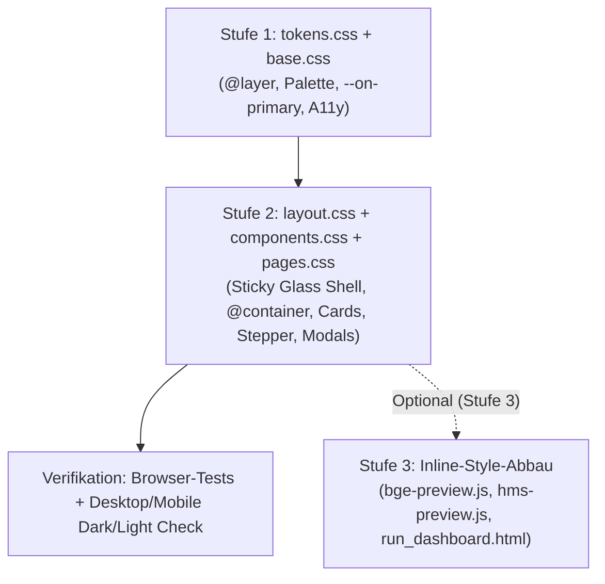

# Implementierungsplan: Modernes Frontend-Redesign (`web_frontend_v3/`)

**Datum:** 2026-11-21  
**Scope:** `web_frontend_v3/css/` (Stufe 1 + 2), optional `bge-preview.js`, `hms-preview.js`, `run_dashboard.html` (Stufe 3)  
**Interaktives Mockup:** [docs/mockups/frontend_v3_observatory_mockup.html](mockups/frontend_v3_observatory_mockup.html)

---

## Zielbeschreibung

Das GUI3-Frontend (`web_frontend_v3/`) erhält ein modernes, kontrastreiches **„Observatory Precision“**-Design (Astrophotographie-Werkbank im Dark- und Light-Mode) — **vollständig ohne Änderung an Funktionalität, Workflows, Routen, State-Management oder DOM-Verträgen**.

Die Modernisierung behebt gleichzeitig alle im Audit gefundenen CSS-Defekte:
- 8 undefinierte CSS-Tokens (`--radius-md`, `--surface-3`, `--text`, `--text-muted`, `--border-strong`, `--accent`, `--tc-border-color`, `--tc-danger`/`--tc-success`)
- WCAG-Kontrastfehler auf Dark-Mode-Primary-Buttons (`#fff` auf `#2dd4bf` ≈ 1,8:1 → Wechsel auf `--on-primary: #042f2e` > 10:1)
- Globales `word-break: break-all` auf allen `.tc-card`-Containern
- Fehlendes Auswahl-Highlight in der Run-History (`.tc-run-item.selected` vs. `.active`)
- Doppelte CSS-Selektoren (`.tc-modal-overlay`, `.tc-diff-added`, `.tc-run-list`)
- Starre Modal-/Path-Picker-Breiten (`min-width: 500px`/`600px`) und überlaufende `.tc-queue-row` auf schmalen Viewports
- Fehlende `:focus-visible`-Ringe und fehlende `@media (prefers-reduced-motion: reduce)`-Unterstützung



---

## Zero-Regression-Vertrag (unveränderliche Schnittstellen)

Folgende DOM-Strukturen, Attribute und Selektoren bleiben **100 % unverändert**:
- **Root-Attribute & Klassen:** `html[data-theme="dark"|"light"]`, `html[lang="de"|"en"]`, `html.tc-dock-open`, `--assistant-width`.
- **Shell- & Navigations-IDs:** `#app-root`, `#toast-container`, `#header-tabs`, `#subtab-bar`, `#content`, `.tc-tab[data-tab]`, `.tc-tab[data-subtab]`, `[data-guardrail]`, `.tc-badge-running`.
- **Tab-Vertrag:** `.tc-tabs`, `.tc-tab`, `.active`, `role="tablist"`/`"tab"`, `aria-selected`.
- **Browser-Test- & Assistenten-Selektoren:** `#assistant-dock`, `.tc-assistant-dock`, `.tc-dock-launcher`, `#resume-config-yaml`, `#resume-panel`, `.tc-hidden`, `#run-list .tc-run-item[data-run-id]`, `.tc-run-archive`, `[data-archive-list]`, `#jev-*`, `#post-run-advice-*`.
- **Live-Image-Viewer & Preview-Canvas:** Alle `.live-image-viewer*`-Klassen, `position: relative; overflow: hidden` auf `__image-wrap`, `position: fixed` auf `__operation-editor`, reines `#000` als Bild-Canvas-Hintergrund.

---

## Offene Entscheidungen vor Umsetzung

1. **Scope:** Nur **Stufe 1 + 2** (100 % reines CSS, null JS-/HTML-Änderungen) oder inkl. **Stufe 3** (`bge-preview.js`, `hms-preview.js`, `run_dashboard.html`)?
2. **Maximale Inhaltsbreite (`--content-max`):** Erweiterung von `1200px` auf `1360px` oder exakt bei `1200px` bleiben?

---

## Vorgeschlagene Änderungen

### Stufe 1: Token-, Kontrast- & Basis-Fundament

- **Dateien:** `web_frontend_v3/css/tokens.css`, `web_frontend_v3/css/base.css`
- **Risiko:** Sehr gering (alle bestehenden Token-Namen bleiben erhalten).

#### `web_frontend_v3/css/tokens.css`
- Cascade-Schichten am Dateianfang deklarieren: `@layer tokens, base, layout, components, pages, utilities;`
- `color-scheme: light` / `color-scheme: dark` setzen (native Scrollbars & Form-Controls passen sich dem Theme an).
- Fehlende Tokens ergänzen: `--on-primary`, `--surface-3`, `--border-subtle`, `--border-strong`, `--radius-md`, `--text`, `--text-muted`, `--accent`, `--content-max`, sowie Z-Index-Tokens (`--z-subtab` bis `--z-viewer-edit`).
- Darkroom-Palette mit feinen Hairline-Borders via `color-mix(in srgb, ...)` und mehrstufigen Elevation-Shadows.

#### `web_frontend_v3/css/base.css`
- In `@layer base` einbetten.
- Subtiler Darkroom-Canvas-Verlauf auf `html[data-theme="dark"] body`.
- `font-variant-numeric: tabular-nums;` für `code, pre, .tc-mono, table`.
- Einheitlicher `:focus-visible`-Ring auf interaktiven Elementen.
- `@media (prefers-reduced-motion: reduce)` deaktiviert Animationen und Transitions.

---

### Stufe 2: Layout, Container Queries & Komponenten-Politur

- **Dateien:** `web_frontend_v3/css/layout.css`, `web_frontend_v3/css/components.css`, `web_frontend_v3/css/pages.css`
- **Risiko:** Gering (alle Klassen und Verträge bleiben kompatibel).

#### `web_frontend_v3/css/layout.css`
- In `@layer layout` (und Utility-Klassen in `@layer utilities`) einbetten.
- Sticky Glassmorphism-Header (`position: sticky; top: 0; backdrop-filter: blur(12px)`) und sticky Sub-Tab-Bar (`top: 56px`).
- Gemeinsame Breite `--content-max` und synchrones Einrücken von `#subtab-bar` + `#content` bei `html.tc-dock-open` (`min-width: 1280px`).
- `container-type: inline-size; container-name: tc-content;` auf `.tc-content` + Container-Query-Breakpoints für `.tc-grid-2`, `.tc-grid-3`, `.tc-grid-sidebar`.

#### `web_frontend_v3/css/components.css`
- In `@layer components` (`.tc-hidden` in `@layer utilities`) einbetten.
- `.tc-btn-primary`: `color: var(--on-primary); font-weight: 600;` (WCAG-AA/AAA-Kontrast).
- `.tc-card`: globales `word-break: break-all` entfernen; verschachtelte `.tc-card .tc-card` als ruhige Inset-Panels stylen.
- `.tc-tabs` / `.tc-tab`: Segmented-Control-Optik beibehalten und aktiven Tab klar abheben.
- `.tc-phase-list` / `.tc-phase-item`: Pipeline-Stepper-Optik mit Glow auf aktivem Dot, `tabular-nums` und Pill-Fortschrittsbalken.
- `.tc-run-item.active, .tc-run-item.selected`: linker Akzentbalken + `var(--primary-soft)` (behebt fehlendes Selection-Highlight).
- Doppelte `.tc-modal-overlay` und `.tc-diff-added` entfernen; Modals & Path-Picker auf `width: min(92vw, 640px)` / `min(92vw, 720px)` umstellen.
- `.tc-queue-row` per `@container tc-content` responsiv umbrechen.
- `.live-image-viewer__chat-bubble--user` & `.live-image-viewer__send-btn` auf `color: var(--on-primary)` umstellen; `#000`-Canvas und Crop-/Editor-Positionierung unverändert lassen.

#### `web_frontend_v3/css/pages.css`
- In `@layer pages` einbetten; doppelte `.tc-run-list` entfernen.
- `@container tc-content`-Breakpoints für `.tc-param-grid`, `.tc-input-scan-grid`, `.tc-tools-grid`.
- `.tc-param-category.active` mit linker Akzentlinie + `:focus-visible`.
- `.tc-log-viewer` mit `tabular-nums` und höherem Kontrast auf den Filter-Buttons.

---

### Stufe 3 *(Optional)*: Inline-Style-Abbau & `run_dashboard.html`

- **Dateien:** `web_frontend_v3/js/components/bge-preview.js`, `web_frontend_v3/js/components/hms-preview.js`, `web_frontend_v3/run_dashboard.html`
- Ersetzen der undefinierten `--tc-border-color`/`--tc-danger`/`--tc-success` Inline-Styles durch bestehende CSS-Tokens/Klassen.
- Einbinden von `css/base.css` und `css/components.css` in `run_dashboard.html`.

---

## Verifikationsplan

### Automatisierte Tests (gemäß `AGENTS.md` mit Umleitung nach `/tmp/out_*.txt`)

```bash
node --test web_frontend_v3/tests/jev_ui.test.mjs > /tmp/out_fe_jev_test.txt 2>&1
node web_frontend_v3/tests/assistant-dock.browser.mjs > /tmp/out_fe_dock_test.txt 2>&1
node web_frontend_v3/tests/assistant-action-card.browser.mjs > /tmp/out_fe_action_test.txt 2>&1
node web_frontend_v3/tests/reason-picker.browser.mjs > /tmp/out_fe_reason_test.txt 2>&1
node web_frontend_v3/tests/run-learning-archive.browser.mjs > /tmp/out_fe_archive_test.txt 2>&1
```

### Manuelle Verifikation (gegen laufendes Backend `http://127.0.0.1:8080/ui`)
1. **Dark- & Light-Mode:** Kontrast aller Primary-Buttons, Status-Badges und Form-Controls.
2. **Desktop (`1440px`, `1280px` mit/ohne Assistant-Dock):** Synchrones Einrücken von Sub-Tab-Bar + Content, Parameter-Studio-3-Spalten-Grid, Run-Monitor-Stepper, Run-History-Selection-Highlight.
3. **Mobile (`768px`, `390px`):** Path-Picker-/Save-As-Modals und Queue-Rows ohne horizontalen Überlauf.
4. **Barrierefreiheit:** Tastaturfokus (`Tab`) auf allen interaktiven Elementen und `prefers-reduced-motion`.
