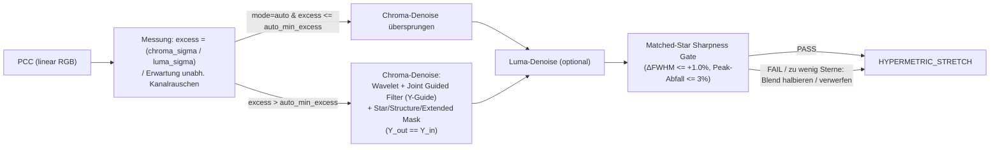

# Implementierungsplan: Automatische, schärfesichere Pipeline-Entrauschung (`chroma_denoise` + `luma_denoise`)

**Datum:** 2026-11-22  
**Scope:** `tile_compile_cpp/` (Konfiguration, Rekonstruktion, Downstream-Runner, Schemas, Tests), `docs/` (Konfigurationsreferenz & Beispiele), `web_backend_cpp/` (Run-Report-Anzeige)

---

## Zielbeschreibung

Die reguläre Stacking-Pipeline (`tile_compile_runner`) soll Farbrauschen und feines Hintergrund-Luminanzrauschen **automatisch und objektagnostisch** reduzieren können, mit einer Prüfung, dass die mediane FWHM heller Sterne um höchstens `max_fwhm_increase_pct` (Standard 1 %) steigt — ohne dass der Nutzer manuell für jeden Datensatz Rauschstärken schätzen muss.

> **Revision 2026-11-22 (nach Review):** Das Auto-Kriterium misst jetzt den Chroma-Rauschüberschuss statt des rohen Verhältnisses; `chroma_guided` und `sharpness_guard` sind standardmäßig aus; das Gate verwirft bei zu wenig messbaren Sternen. Begründungen in den Abschnitten unten und unter „Review-Korrekturen“.

Kernprinzipien:
1. **Luminanz-geführter Joint Guided Filter für Chroma (`chroma_denoise`):** Nutzt die scharfe lineare Luminanz `Y` als Führungsbild (`O(N)`, 32-Bit-Float), sodass Stern- und Nebelkanten Farbbluten stoppen und `Y_out == Y_in` gilt (die Luminanz-FWHM bleibt unverändert; Farbsäume der Sterne ändern sich, das ist der Zweck). Standard: aus.
2. **Auto-Aktivierung auf dem Chroma-Rauschüberschuss (`mode: off | manual | auto`):** Misst `ratio = input_chroma_sigma / input_luma_sigma` (Pixel-Hochpass, gültige Pixel) und teilt es durch das Verhältnis, das unabhängiges Rauschen mit den gemessenen Kanal-Sigmas im gewählten `color_space` ergäbe: `excess = ratio / expected_ratio`. `1` = unabhängiges Kanalrauschen, `< 1` = von den Kanälen geteiltes Rauschen, `> 1` = zusätzliches Farbrauschen. Bei oder unter `auto_min_excess` wird übersprungen, ab `auto_full_excess` voller Blend, dazwischen linear.
3. **Fail-Closed Schärfe-Gate für `luma_denoise` (`sharpness_guard`):** Vergleicht vor/nach `luma_denoise` die mediane FWHM und den Sternpeak heller Sterne (`>= 10 sigma`) **auf identisch gematchten Sternpositionen** (`AGENTS.md`-Invariante). Bei Verschlechterung oberhalb der Toleranz wird `blend_amount` halbiert; reicht das nicht, oder sind weniger als `min_matched_stars` Sterne messbar, wird der Pass verworfen. Schwache flächige Details prüft das Gate nicht. Standard: aus.



---

## Abhängigkeitsreihenfolge & Vorgeschlagene Änderungen

### 1. Konfiguration & Schema-Synchronisation (`tile_compile_cpp/`)

Gemäß `AGENTS.md` müssen C++-Structs, YAML-Parser/Validator, JSON-/YAML-Schemas, `tile_compile.yaml` und Dokumentation exakt übereinstimmen.

- **`tile_compile_cpp/include/tile_compile/config/configuration.hpp`**
  - In `ChromaDenoiseConfig`:
    - `std::string mode = "manual";` (`"off" | "manual" | "auto"`, rückwärtskompatibel zu `enabled: true/false`).
    - `float auto_min_excess = 0.5f;` (bei oder unter diesem Überschuss wird in `mode: auto` übersprungen; vorläufig, nicht geeicht).
    - `float auto_full_excess = 1.0f;` (ab diesem Überschuss voller konfigurierter `blend.amount`; vorläufig).
    - `struct ChromaGuidedConfig { bool enabled = false; int radius = 4; float eps_sigma_scale = 2.0f; } chroma_guided;`
  - In `LumaDenoiseConfig`:
    - `struct SharpnessGuardConfig { bool enabled = false; float max_fwhm_increase_pct = 1.0f; int min_matched_stars = 15; int max_backoff_steps = 2; } sharpness_guard;`
- **`tile_compile_cpp/src/io/config.cpp`**
  - Parsing, Serialisierung und Bereichsvalidierung für alle neuen Felder (`radius` in `[1,64]`, `auto_min_excess >= 0`, `auto_full_excess > auto_min_excess`, `max_fwhm_increase_pct` in `[0,100]`).
- **`tile_compile_cpp/tile_compile.schema.json` & `tile_compile.schema.yaml` & `tile_compile.yaml`**
  - Exakte Abbildung aller neuen Keys, Typen, Grenzen und Defaults. Bestehende Konfigurationen liefern dasselbe Ergebnis, auch mit `enabled: true`: `chroma_guided` und `sharpness_guard` sind aus, `mode` ist `manual`. Im YAML-Schema steht `'off'` in Anführungszeichen (sonst liest YAML 1.1 es als Boolean).

---

### 2. Algorithmen & Gates (`tile_compile_cpp/src/reconstruction/`)

- **`tile_compile_cpp/src/reconstruction/chroma_denoise.cpp` & `include/.../chroma_denoise.hpp`**
  - Implementierung von `guided_filter_chroma_plane(Y_guide, C_plane, valid_mask, radius, eps)` in 32-Bit-Float (`O(N)` via `cv::boxFilter`, Randbehandlung für ungültige Overlap-Pixel).
  - Einbindung in `chroma_denoise_rgb_inplace(...)` nach/statt `chroma_bilateral` wenn `cfg.chroma_guided.enabled == true`.
  - In `mode == "auto"`: `auto_scale = clamp((excess - auto_min_excess) / (auto_full_excess - auto_min_excess), 0, 1)` mit `excess = ratio / expected_ratio`; `expected_ratio` aus den Hochpass-Sigmas von R, G, B und den Gewichten des `color_space` (ycbcr: Y = (.25,.5,.25), C1 = (−.25,−.5,.75), C2 = (.75,−.5,−.25); opponent: Y = (⅓,⅓,⅓), C1 = (1,−1,0), C2 = (0,−1,1); Plane-Sigma `sqrt(Σ w_i² σ_i²)`). Bei `auto_scale <= 0` Skip mit `skip_reason = "chroma_noise_below_threshold"`. `adapt` bleibt auf dem rohen Verhältnis, `manual` ist damit unverändert.
  - Erweiterung von `ChromaDenoiseStats` um `auto_mode_scale`, `guided_applied`, `measured_chroma_to_luma_ratio`, `expected_chroma_to_luma_ratio`, `chroma_noise_excess`, `skip_reason`.
- **`tile_compile_cpp/src/reconstruction/luma_denoise.cpp` & `include/.../luma_denoise.hpp`**
  - Implementierung des **Matched-Star Sharpness Gates**:
    - Sterne einmalig auf dem Eingangs-`Y` detektieren (innerhalb `common_overlap_mask`, ungesättigt).
    - Mediane FWHM auf exakt diesen Sternpositionen vor (`fwhm_before`) und nach (`fwhm_after`) dem Blend messen.
    - Sind weniger als `min_matched_stars` Sterne vorher und nachher messbar: verwerfen (`applied = false`, Originalbild, `guard_reason = "insufficient_stars"`), da ein Schärfeverlust nicht auszuschließen ist.
    - Sonst bei `(fwhm_after - fwhm_before) / fwhm_before * 100 > max_fwhm_increase_pct` oder Peak-Abfall `> max(3 %, 3 × max_fwhm_increase_pct)` (fest, nicht konfigurierbar): `effective_blend_amount *= 0.5f` und erneut prüfen (bis `max_backoff_steps`), danach verwerfen (`guard_reason = "fwhm_regression"` bzw. `"star_peak_erosion"`).
    - Jeder Ausgang setzt `guard_reason`: `disabled`, `passed`, `insufficient_stars`, `fwhm_regression`, `star_peak_erosion`.
  - Erweiterung von `LumaDenoiseStats` um `effective_blend_amount`, `fwhm_before`, `fwhm_after`, `fwhm_delta_pct`, `matched_stars`, `guard_rejected`, `guard_reason`, `backoff_steps`.

---

### 3. Downstream-Runner, Report & Dokumentation

- **`tile_compile_cpp/apps/runner_downstream.cpp`**
  - Alle neuen Diagnostikfelder in `artifacts/chroma_denoise.json` und `artifacts/luma_denoise.json` serialisieren.
  - Sicherstellen, dass `chroma_denoise` im Default-Fluss `post_pcc` (linear, *vor* `HYPERMETRIC_STRETCH`) greift.
- **`web_backend_cpp/src/services/report_generator.cpp`**
  - In der Sektion `Luma and Chroma Denoise` zusätzlich `fwhm_before → fwhm_after (Δ%)`, `guard_rejected` / `guard_reason`, `auto_mode_scale`, `ratio` und `excess` anzeigen.
- **Dokumentation (`docs/configuration_reference.md`, `configuration_reference_en.md`, `configuration_examples_practical_de.md`, `configuration_examples_practical_en.md`)**
  - Alle neuen Parameter (Einheiten, Bereiche, Defaults, Interaktionen, Fallback-Verhalten) gemäß `AGENTS.md` dokumentieren.

---

## Risiko & Blast Radius

- **Blast Radius:** Begrenzt auf Downstream-Denoise-Phasen (`chroma_denoise`, `luma_denoise`), Konfigurations-Schemas und Report-Anzeige. Rekonstruktionsphasen (`FORWARD_DRIZZLE`, `MULTIBAND`) bleiben 100 % unberührt.
- **Risiko:** Bestehende Konfigurationen behalten ihr Ergebnis (`mode: manual`, `chroma_guided` und `sharpness_guard` aus). Die Auto-Schwellen sind vorläufig: belegt ist nur, dass unabhängiges Kanalrauschen einen Überschuss von ≈ 1 ergibt; an echten Stacks geeicht sind sie nicht (bisher ein M31-Datensatz mit rohem Verhältnis 4,04, ohne Kanal-Sigmas). Das Hochpass-Sigma sieht großflächiges Farb-Mottling (15–40 px) nicht. Das Gate prüft nur helle Sterne.

---

## Verifikationsplan

```bash
# 1. JSON/YAML-Schemas validieren
python3 -c 'import json, yaml; json.load(open("tile_compile_cpp/tile_compile.schema.json")); yaml.safe_load(open("tile_compile_cpp/tile_compile.schema.yaml")); yaml.safe_load(open("tile_compile_cpp/tile_compile.yaml")); print("SCHEMA_OK")' > /tmp/out_denoise_schema_check.txt 2>&1

# 2. C++ Pipeline + Runner bauen & gezielte + komplette Catch2-Tests
CCACHE_DISABLE=1 cmake --build tile_compile_cpp/build --target tile_compile_runner tests -j4 > /tmp/out_denoise_cpp_build.txt 2>&1
./tile_compile_cpp/build/tests "[chroma-denoise],[luma-denoise]" > /tmp/out_denoise_cpp_tests.txt 2>&1
./tile_compile_cpp/build/tests > /tmp/out_denoise_cpp_full.txt 2>&1

# 3. Backend-Report-Tests
CCACHE_DISABLE=1 cmake --build web_backend_cpp/build --target tile_compile_web_backend web_backend_cpp_report_forward_drizzle -j4 > /tmp/out_denoise_be_build.txt 2>&1
ctest --test-dir web_backend_cpp/build -R "report_" --output-on-failure > /tmp/out_denoise_be_ctest.txt 2>&1
```

**Neue Unit-Tests (`test_chroma_denoise.cpp`, `test_luma_denoise.cpp`):**
1. Joint Guided Filter erhält exakte Luminanz (`max(|Y_out - Y_in|) < 1e-5`) und reduziert Chroma-Rauschen > 50 % ohne Sternfarbbluten.
2. `mode: auto`: von allen Kanälen geteiltes Rauschen ergibt Überschuss ≈ 0 und Skip; unabhängiges Kanalrauschen ergibt ≈ 1 bei zwei Amplituden, ungleichen Kanal-Verstärkungen und beiden Farbräumen (das rohe Verhältnis unterscheidet sich dabei); gegenläufiges R/B-Rauschen ergibt > 1 und vollen Blend.
3. Defaults: `chroma_guided` und `sharpness_guard` aus; `enabled: true` ohne `chroma_guided` setzt `guided_applied = false`.
4. `sharpness_guard` erkennt eine künstlich erzwungene FWHM-Verschlechterung auf gematchten Sternen und verwirft (`fwhm_regression`/`star_peak_erosion`), lässt geschützte Sterne passieren (`passed`), verwirft bei 0 und 3 Sternen (`insufficient_stars`, Bild unverändert) und meldet ausgeschaltet `disabled`.

---

## Review-Korrekturen (2026-11-22)

1. **Auto-Kriterium.** Das rohe `chroma_sigma / luma_sigma` hängt vom `color_space` und von den Kanal-Verstärkungen ab: unabhängiges, gleich starkes Kanalrauschen ergibt in `ycbcr_linear` ≈ 1,53, in `opponent_linear` ≈ 2,45, beides über der alten Vollschwelle 1,10; drei M31-Läufe maßen 4,04. Mit den alten Schwellen wäre `auto` praktisch immer volle Stärke gewesen, und „saubere Stacks werden übersprungen“ traf nicht zu. Ein absolutes Rauschmaß ist kein Ersatz: nach BGE liegt der Hintergrund bei ≈ 0, und der Stretch überträgt Farbe relativ zur Luminanz (Schwarzpunkt am Median), sichtbar ist also das Verhältnis. Deshalb der auf unabhängiges Kanalrauschen normierte Überschuss.
2. **Defaults.** `chroma_guided.enabled` und `sharpness_guard.enabled` standen auf `true` und hätten das Ergebnis bestehender Konfigurationen mit `enabled: true` geändert (Chroma: dreifache Filterung; Luma: Gate mit möglichem Verwerfen). Beide jetzt `false`.
3. **Gate bei zu wenig Sternen.** Vorher lief der Pass bei weniger als `min_matched_stars` Sternen ungeprüft mit vollem Blend durch — fail-open, im Widerspruch zu „fail-closed“. Jetzt verworfen mit `insufficient_stars`.
4. **Zusagen.** „Nachweislich ohne Schärfeverlust“ / „0 % FWHM-Einfluss“ eingeschränkt auf: mediane FWHM heller Sterne ≤ +`max_fwhm_increase_pct`, Luminanz beim Chroma-Pass exakt.
5. **Pfad, Diagramm, Tags.** `src/io/config.cpp` statt `src/config/configuration.cpp`; Luma hat keinen Auto-Modus; Peak-Regel dokumentiert; Catch2-Tags heißen `[chroma-denoise]`/`[luma-denoise]`.
6. **Nicht im Plan:** die Erweiterung von `web_backend_cpp/src/services/pi/pi_image_ops.cpp` (Denoise-Werkzeug des PI-Backends) gehört nicht zu diesem Plan und ist hier nicht geprüft.

## Nachtrag: Test an IC434 und Folgen (2026-11-22)

Getestet an Kopien von `ic434a1_20261122_150803` (Fortsetzung ab BGE bzw. PCC, Referenz `outputs/stacked_rgb_hms.fits` des Originals):

- Chroma `auto`: Überschuss 2,68 → volle Stärke (gemessen im Lauf mit Luma-Pass, also aufgebläht; ohne ihn 0,98, siehe Punkt 15). Luma mit `sharpness_guard`: `passed`, 120 Sterne, FWHM linear +0,006 %.
- Im linearen Bild arbeitet der Chroma-Pass wie geplant: Luminanz bitgenau erhalten, Sterne unverändert.
- Im Endbild aber: nur Chroma → sichtbares Luma-Rauschen +12 %, Sterne +2 % breiter. Ursache ist nicht der Denoise, sondern die Ausgabeskalierung von HMS: ihr Abstand Himmel–Schwarzpunkt folgt den Extremwerten des Kanalrauschens (−9 %), der MTF hebt den Himmel dann steiler an (Mittelton 0,151 → 0,137). Das Gate misst im linearen Bild und sieht das nicht.

Folgen:

7. **`hypermetric_stretch.params_from_pre_denoise`** (Standard aus): HMS übernimmt alle abgeleiteten Parameter aus dem Zustand direkt vor dem Chroma-Pass. An IC434 mit Schalter: alle Parameter identisch mit dem Lauf ohne Denoise, Luma-Rauschen ×1,000, Stern-FWHM ±0 %, Farbrauschen weiter reduziert. Ohne Schalter bleibt das Endbild byte-identisch. Ersetzt `anchor_from_reference` (siehe `docs/hms_anchor_reference_20260927_de.md`, Nachtrag).
8. **Adaption auf den Überschuss.** `adapt` wertete weiter das rohe Verhältnis aus — derselbe Fehler wie beim alten Auto-Kriterium; unabhängiges Kanalrauschen landete damit fast immer bei 1,4. Jetzt `adaptation = clamp(Überschuss / adaptation_reference_excess, 0,8, 1,4)` (Schlüssel umbenannt von `adaptation_reference_ratio`, Migration beim Laden). **Ändert das Ergebnis** jedes Laufs mit Chroma-Denoise und gewöhnlichem Rauschen: 1,0 statt 1,4, also Blend 0,85 statt 1,0 und Wavelet-Schwelle 2,5 statt 3,5. IC434 selbst prüft das nicht (Überschuss 2,68 → 1,4 wie vorher); belegt ist es nur durch den Unit-Test.
9. **HMS-Vorschau im Backend** (`hme_preview_service.cpp`): verwendet `pcc_predenoise_*.fit`, wenn vorhanden, wie der Runner; sonst wiche die Vorschau eines Laufs mit Schalter vom Endbild ab. Test `web_backend_cpp_hme_preview`.
10. **Reiner HYPERMETRIC_STRETCH-Resume:** an IC434 nicht testbar (Original-Config mit Chroma aus). Nachgeholt an M31 (siehe unten, Punkt 14): lädt `pcc_predenoise_*.fit`, Endbild byte-identisch mit dem vollen Lauf.
11. **HMS-Diagnose:** `phase_end` von HYPERMETRIC_STRETCH enthält `output_scaling` (`floor_margin`, `margin_source`, `scale`, `scale_source`, `mtf_midtone`), `params_source` und `params_from_pre_denoise` (Grund).

## Nachtrag: HMS-Luminanz und Luma-Ausgleich (2026-11-22)

Getestet an M31_F1 und M42 zeigten sich zwei weitere Ursachen:

- Der Chroma-Pass erhält Y = 0,25R + 0,5G + 0,25B, HMS streckt aber die Luminanz des Sensorprofils (IMX415: 0,2703/0,5405/0,1892). Ein Teil des Farbrauschens landet so in der gestreckten Luminanz (M42 +6 %, M31 +19 %).
- `luma_denoise` läuft vor BGE/PCC. Die Vor-Denoise-Referenz enthielt ihn deshalb schon. Ergebnis: Er verschob die Stretch-Parameter (M42: Mottling +18–26 %, FWHM +9,5 %) und blähte den gemessenen Chroma-Überschuss auf (0,97 → 2,40).

12. **`chroma_denoise.preserve_luminance: hms_profile`** (Standard `color_space`): Nach dem Pass stellt ein gemeinsamer Offset je Pixel die HMS-Luminanz exakt wieder her. Die Kanaldifferenzen, also die Farbe, bleiben wie entrauscht. M42: HMS-Luminanz-Rauschen +6,2 % → +0,8 %. M31 (nur dieser Schlüssel gegenüber dem Original): Luminanz-Pixelrauschen ×0,88, Farbe ×0,95–1,0, FWHM ±0.
13. **Post-Stack-Delta:** Die Änderung der Post-Stack-Pässe (nachher − vorher) wird festgehalten und am PCC-Punkt mit dem linearen Anteil von PCC herausgerechnet. BGE zieht je Kanal ab, PCC ist in `affine_diagonal`/`linear` linear plus Offsets (`PCCResult::applied_linear`); in den `attenuated`-Modi geht das nicht (`pcc_apply_nonlinear`). Rückgerechnet wird vor dem Speckle-Unterdrücker, der danach auch auf der Referenz läuft. Grund: Die Ausgabeskalierung von HMS hängt am Minimum jedes Kanals, und genau diese Einzelpixel behandelt der Unterdrücker. Im ersten Versuch (Rückrechnung danach) lag die Margin an M42 26 % zu tief. Das Delta liegt für einen PCC-Resume in `outputs/post_stack_denoise_delta_R.fit` bzw. `_{R,G,B}.fit`. Die Referenz dient zwei Zwecken:
    - `hypermetric_stretch.params_from_pre_denoise` gleicht jetzt auch `luma_denoise` (und Chroma bei `post_stack_linear`) aus. Diagnose `pre_denoise_post_stack`.
    - **`chroma_denoise.excess_from_pre_denoise`** (Standard aus) misst den Überschuss an der Referenz. M42 0,97 statt 2,40, M31 0,97 statt 1,93.
14. **Messung an Kopien** (alle Läufe ab BGE, Bezug „ohne Denoise“):

    | | M42 alt (Luma + Chroma + Schalter) | M42 neu (+ beide Schlüssel) | M31 Original | M31 neu (+ Schalter, beide Schlüssel) |
    |---|---|---|---|---|
    | Luma-Pixelrauschen | ×0,47 | ×0,24 | ×0,47 | ×0,40 |
    | Luma-Mottling 8 / 32 px | ×1,18 / ×1,26 | ×0,90 / ×1,03 | ×0,97 / ×1,05 | ×0,91 / ×1,00 |
    | Farb-Pixelrauschen | ×0,001–0,004 | ×0,09 | ×0,004–0,008 | ×0,035 |
    | Stern-FWHM | +9,5 % | ±0,00 % | +2,5 % | ±0,00 % |
    | Mittelton (ohne Denoise) | 0,041 (0,055) | 0,0549 (0,0551) | 0,0328 (0,0370) | 0,0362 (0,0370) |

    - Bei M31 bleiben 2 % Abstand im Mittelton. Das ist kein Rechenfehler: Im Lauf mit Denoise setzen BGE und die Neutralisierung den Hintergrund um 0,15–0,36 tiefer, und die an 0 abgeschnittenen Minima machen daraus 2–3 % Margin. Die Referenz gibt den Hintergrund des tatsächlichen Laufs wieder, und gegen diesen werden die eingefrorenen Floors angewandt.
    - Das Farbrauschen fällt im neuen Lauf schwächer, weil die Adaption jetzt den richtigen Überschuss sieht (0,97 statt 1,4); das Farb-Mottling bleibt praktisch gleich.
    - Geprüft sind alle drei Pfade: der volle Lauf ab BGE, der PCC-Resume mit dem Delta aus der Datei (byte-identisch mit dem vollen Lauf) und der HYPERMETRIC_STRETCH-Resume mit `pre_denoise_post_stack: from_saved_reference` (ebenso byte-identisch).
    - Ohne die neuen Schlüssel bleibt alles byte-identisch: M42 und M31 mit Original-Config, IC434 Basis und IC434 Chroma `auto` + Schalter.

## Nachtrag: Standardwerte (2026-11-23)

15. **Die drei Schalter sind jetzt Standard:** `hypermetric_stretch.params_from_pre_denoise: true`, `chroma_denoise.preserve_luminance: hms_profile`, `chroma_denoise.excess_from_pre_denoise: true`. Ohne aktiven Denoise-Pass ändern sie nichts (`params_from_pre_denoise: denoise_inactive`); wer das alte Verhalten will, setzt sie ausdrücklich zurück. Eine Config, die sie ausdrücklich setzt, bleibt wie sie ist; ein Resume vergleicht beide Configs mit denselben Standards, die Bereichsprüfung schlägt deshalb nicht an. Läufe mit Denoise, deren Config die Schlüssel nicht nennt, ergeben bei einem neuen Lauf oder Resume ein anderes Endbild als vorher.
    - Geprüft an Kopien, Config ohne die Schlüssel: M42 ohne Denoise und M31 ohne Denoise byte-identisch mit den Läufen davor, IC434 ohne Denoise ebenso. M42 Luma + Chroma `auto` byte-identisch mit dem Lauf, der alle Schlüssel von Hand setzte (D4), M31 mit Original-Config byte-identisch mit E2.
    - **Erkennung:** IC434 ohne Luma-Pass hat einen Überschuss von 0,98, nicht 2,68 (der Wert aus Punkt „Test an IC434“ stammt aus dem Lauf mit Luma). Alle drei Datensätze liegen damit bei 0,97–0,98, also gewöhnlichem unabhängigem Kanalrauschen: `auto` läuft mit Stärke 0,94–0,96 und Adaption ≈ 0,98. Übersprungen wird erst unter 0,5 (von den Kanälen geteiltes Rauschen); die Schwellen sind weiter nicht an Daten mit echtem Zusatz-Farbrauschen geeicht.
    - IC434 (Bezug: ohne Denoise):

    | | Chroma `auto`, vorher | Chroma `auto`, neu | Luma + Chroma, vorher | Luma + Chroma, neu |
    |---|---|---|---|---|
    | HMS-Luminanz, Pixelrauschen | ×1,051 | ×1,002 | ×0,389 | ×0,207 |
    | HMS-Luminanz, Mottling 8 / 32 px | ×1,028 / ×1,002 | ×1,002 / ×1,002 | ×1,020 / ×1,179 | ×0,866 / ×1,059 |
    | Farb-Pixelrauschen | ×0,07 | ×0,07 | ×0,001 | ×0,07 |
    | Farb-Mottling 32 px | ×0,86 | ×0,86 | ×0,98–1,02 | ×0,85–0,90 |
    | Stern-FWHM | ±0,00 % | ±0,00 % | +4,45 % | ±0,00 % |

