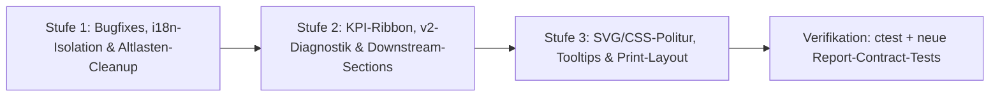

# Implementierungsplan: Überarbeitung der Post-Run-Statistiken („Stats erzeugen“)

**Datum:** 2026-11-21  
**Scope:** `web_backend_cpp/src/services/report_generator.cpp`, `web_frontend_v3/i18n/report_de.json`, `web_frontend_v3/i18n/report_en.json`, `web_backend_cpp/tests/test_report_forward_drizzle.cpp`, `web_backend_cpp/tests/test_report_phase_issues.cpp`

---

## Zielbeschreibung

Der Post-Run-Report-Generator wird in 3 Stufen auf den Stand der aktuellen **CFA Forward Drizzle + Multiband**-Pipeline gebracht:

1. **Stufe 1 — Korrektheit, Schema-Fixes & i18n-Reparatur:** Defekte Sections reparieren (`gen_frame_usage`, BGE-Apply-Guard, WCS-Pixelmaßstab), CSS-/YAML-Korruption durch `apply_report_translations()` beseitigen, falsche Scatter-Erklärungen korrigieren, redundante/tote Blöcke und verwaiste Legacy-i18n-Keys entfernen.
2. **Stufe 2 — Neue Diagnostik aus bereits vorhandenen Artefakten:** Executive KPI-Ribbon + Sprungnavigation (TOC), Candidate-Delta-Tabelle vs. `drizzle_uniform`, v2-Estimator-/Bimodal-Veto-/Timing-Breakdown, Registrierungs-Kaskade & Stern-Residuen, photometrische Skala `P_*`, erweiterte Frame-Metriken (`wfwhm`, `fwhm_x/y`, `g_quality` vs. `g_eff`) sowie neue Downstream-Sections (**Astrometry/WCS**, **PCC**, **BGE-Details**, **HyperMetric Stretch**, **Luma-/Chroma-Denoise**, **Speicher-Breakdown**).
3. **Stufe 3 — HTML/SVG/UX-Politur & Tests:** `.data-table` von `.kv` trennen, dynamische SVG-Labelbreiten, Colorbar-Titel, `<title>`-Hover-Tooltips, `@media print` sowie erweiterte Report-Contract-Tests.



---

## Stufe 1: Korrektheit, Schema-Fixes & i18n-Reparatur

- **i18n-Isolation (`report_generator.cpp`):** `apply_report_translations()` ausschließlich auf Header- und Content-Fragmente (`<!--REPORT_HEADER_BEGIN-->..END`, `<!--REPORT_CONTENT_BEGIN-->..END`) sowie Config-Summary/Footer anwenden — niemals auf `<style>` oder `<pre>config.yaml</pre>`.
- **`gen_frame_usage()` reparieren:** Reale Zähler aus `global_registration.json` (`extra.reg_rejected_frames`, `extra.frames_cc_*`), `registration_sampling.json` (`frames[].valid`) und `FORWARD_DRIZZLE` `phase_end` (`v2_frames_participating`) lesen statt leerer `REGISTRATION` `phase_end`-Felder.
- **BGE-Apply-Guard (`render_bge_phase_details`):** `bge["config"]["classic"]["min_valid_sample_fraction_for_apply"]` / `min_valid_samples_for_apply` lesen mit Fallback auf flaches `bge["config"]` (Rückwärtskompatibilität).
- **WCS-Pixelmaßstab:** Aus `ASTROMETRY` `phase_end` (`pixel_scale_arcsec`, `solver`) statt `"deferred to M10"`.
- **Scatter-Erklärungen & Colorbar-Titel:** `FWHM vs roundness` → Farbe = `star_count`, `Translation scatter` → Farbe = `CC`; Colorbar beschriften.
- **Altlasten entfernen:** Redundante Card 4 („Noise diagnostics“) durch v2-Estimator-/Veto-Diagnostik ersetzen, Legacy-Wording (`all reconstruction methods`, `PREWARP`, `Synthetik`, `lokalen Metriken`) und tote Helfer (`TileSeries`, `json_optional_bool`, `finite_json_number`, `json_diag_values`, `sample_evenly`) entfernen.
- **`report_de.json` / `report_en.json`:** Verwaiste Legacy-Keys bereinigen und fehlende aktive Übersetzungen ergänzen.

---

## Stufe 2: Neue Diagnostik & Downstream-Sections

- **Executive KPI-Ribbon + Section-TOC:** Kompakte Übersicht (Status, Frames, gewählter Kandidat + `ΔFWHM %`/`ΔBG RMS %`, Coverage-Gate, Laufzeit, WCS-Skala, Peak RSS) + Anker-Navigation.
- **Candidate-Delta-Tabelle vs. `drizzle_uniform`:** Farbcodierte Deltas (`ΔFWHM %`, `Δp90_fwhm %`, `Δtail`, `Δelongation`, `Δbackground_rms %`, `Δseam_score`), `multiband_star_sample_count`, `selection_reason`.
- **v2-Estimator-, Clipping-, Bimodal-Veto- & Timing-Breakdown-Card:** `v2_estimator`, `full_frame_accepted/rejected/degenerate_pilot/no_bounds`, `bimodal_veto_*`, `bands_committed/reused`, `read_amplification`, `alpha_near_zero_fraction`, Sub-Timings als Balkendiagramm.
- **Registrierungs-Kaskade, Stern-Residuen & Refinement:** `reg_source_counts`, `reg_reject_*`, `meridian_flip_detected`, `dithering`, `star_residuals[]`, Affine/Local-Refinement Before/After + `jacobian_determinant`.
- **Normalisierung, Frame-Metriken & Source Quality:** Photometrische Skala `P_*`, `wfwhm`, `fwhm_x/y`, `sky_gradient`, alle 6 Gewichtskomponenten, `g_quality` vs. `g_eff`.
- **Neue Downstream-Sections:** Astrometry/WCS, PCC (Sterne, RMS, 3×3-Matrix, Determinante, Konditionszahl), BGE (`auto_detect`, `autotune`, Guard Pre/Post), HyperMetric Stretch (`log_d`, `anchor`, `black/white_clip_percent`, Color-Cast-Correction, Large-Scale-Contrast), Luma-/Chroma-Denoise (`luma_denoise.json`, `chroma_denoise.json`) sowie Speicher-/Working-Set-Breakdown.

---

## Stufe 3: HTML/SVG/UX-Politur & Tests

- `.data-table` getrennt von `.kv th { width: 36%; }`, `font-variant-numeric: tabular-nums`.
- Dynamische `x0`-Breite in `svg_bar_horizontal`, kollisionsfreie Histogramm-X-Achsen, `<title>`-Tooltips auf SVG-Elementen, `@media print`.
- Erweiterte Assertions in `test_report_forward_drizzle.cpp` und `test_report_phase_issues.cpp` (CSS-/YAML-Integrität im DE-Report, `Frame Usage`, `bge.config.classic`, neue Downstream-Sections).

---

## Verifikationsplan

```bash
python3 -c 'import json; [json.load(open(p)) for p in ("web_frontend_v3/i18n/report_de.json", "web_frontend_v3/i18n/report_en.json")]' > /tmp/out_report_i18n_json.txt 2>&1
CCACHE_DISABLE=1 cmake --build web_backend_cpp/build --target tile_compile_web_backend web_backend_cpp_report_forward_drizzle web_backend_cpp_report_phase_issues -j4 > /tmp/out_report_build.txt 2>&1
ctest --test-dir web_backend_cpp/build -R "report_" --output-on-failure > /tmp/out_report_ctest.txt 2>&1
```
